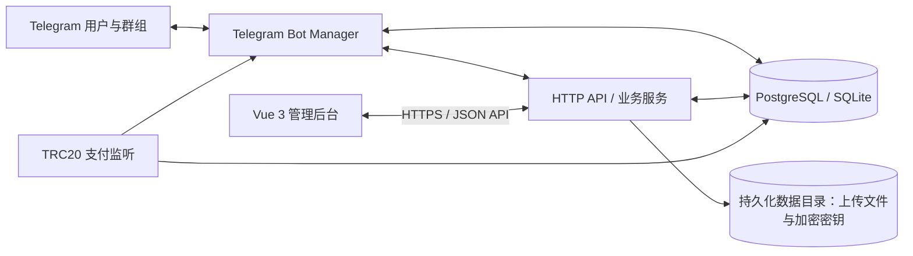

## 2026-11-18 — PR2 已发布并通过生产验收；Dujiao-Next PR C 启动

- 状态：PR #30（PR2）已合并，Go CI、Admin CI、安全扫描和 Docker Publish 全部成功；项目所有者确认生产已更新至 PR2 镜像，PR #19、#26、#28 与 PR2 验收均按默认通过记录（2026-11-18）。Dujiao-Next PR C 进入独立开发阶段。
- PR #28 merge commit：`6bbb749e0c89f95ee5e37aa21d92a14bd916a6c6`；PR2 merge commit：`75a635a6c5e9c68e8fc23c229f932119dca46a93`。
- PR #28 历史验收镜像 digest：`sha256:89cd1443e63282e171c026460c545fce73e5ad9514c4b6452abe8b6b01fd1f04`；PR2 当前生产镜像 digest：`sha256:bca6cc3c12df3bd667c8ee269f0ab9794d39a6dda47d1d185ad0894203c4796e`；Publish Run [#44324284760](https://github.com/seanldnet/TG-Card/actions/runs/44324284760)。
- Go CI [#44317232633](https://github.com/seanldnet/TG-Card/actions/runs/44317232633) 与 Security [#44317232660](https://github.com/seanldnet/TG-Card/actions/runs/44317232660) 均成功。
- Admin frontend CI 未对 PR #28 运行：原 workflow 对 `web/**`、`scripts/**`、README 和 workflow 文件使用 paths 过滤；PR #28 未改动这些路径。已在本次文档修正分支移除路径过滤，后续 main push / PR 均执行 Admin CI。
- 验收日期：2026-11-18。PR #19/#26/#28 项目项按 PR #28 基准镜像 `sha256:89cd1443e63282e171c026460c545fce73e5ad9514c4b6452abe8b6b01fd1f04` 记录；PR2 项按 `sha256:bca6cc3c12df3bd667c8ee269f0ab9794d39a6dda47d1d185ad0894203c4796e` 记录。验收结论依据项目所有者确认生产已更新且未收到异常反馈。

# TG-Card 项目现状与功能总览

> 本文是项目当前实现状态的主文档。内容以 `main` 分支源码、数据库迁移、后台页面和现有技术文档为依据；产品规划不等于已交付功能。每次开发、修复、重构或发布都必须同步更新本文和 `docs/CHANGELOG.md`。

> **文档元信息**
> - 最后更新时间：2026-11-18
> - 文档版本：2.0.0
> - 源码核对基线：`main` 分支，commit `a9a01e6ef41a1047c37f1180501fcf30294a4cd0`（PR #31 生产验收文档已合并；PR C 当前在独立 PR #32 分支开发）
> - 本次文档更新：记录 PR #19/#26/#28/PR2 生产验收通过；PR C 独立 PR #32 开发中，CI/模拟测试待最终确认；PR D/E 仍未完成

- 项目：TG-Card
- 仓库：https://github.com/seanldnet/TG-Card
- 默认分支：`main`
- 文档维护原则：代码是事实来源；无法从代码或测试确认的功能，不得标记为“已完成”。
- 状态定义：
  - **已实现**：代码中存在完整主要路径或后台/API入口。
  - **部分实现**：已有可用基础路径，但仍有明确限制。
  - **待开发**：只有规划、占位或尚无完整实现。
  - **待验收**：代码已提交或合并，但尚未完成目标环境端到端验证。

## 1. 产品定位与边界

TG-Card 是**单商户、多 Telegram Bot 的自动发卡商城**。多个 Bot 共用同一套商品、库存、用户、订单、支付和售后数据；Bot 负责用户交互与交付，网页管理后台负责完整配置。

当前产品边界：
- 单商户、单管理员后台，不是多租户 SaaS。
- 不包含代理商、代理余额、分销佣金体系。
- 多个 Bot 共用商品与订单核心，但可分别配置 Bot Token、欢迎内容、购买须知、介绍、Owner 和客服/群组链接。
- 管理后台是商品、库存、订单、支付设置及运营数据的主要管理入口。

## 2. 技术架构

| 层 | 当前实现 |
|---|---|
| 后端 | Go HTTP API，入口 `cmd/server` |
| 前端 | Vue 3 + TypeScript + Vite + Ant Design Vue，基于 Vue Vben Admin 5.x |
| 前端定制 | `web/overrides/`；上游 Vben 通过 Git Submodule 固定版本 |
| 数据库 | Docker 默认 PostgreSQL 16；独立运行支持 SQLite / PostgreSQL |
| 数据迁移 | `internal/database/migrations/*.sql`，启动时自动执行版本迁移 |
| Telegram | 自建 Bot Manager，使用 Telegram Bot API 长轮询接收消息及回调 |
| 敏感数据 | 应用数据目录中的持久化密钥；Bot Token、支付 API Key 等加密保存 |
| 部署 | Docker Compose + GHCR 预构建镜像，支持 linux/amd64、linux/arm64 |
| CI | Go CI、Admin 前端 CI、安全扫描、Docker 镜像构建发布 |

主要目录：
- `cmd/server/`：HTTP 服务、API 路由、支付/订单/售后管理逻辑。
- `internal/telegrambot/`：Bot 运行时、用户菜单、回调、发货、广播与定时任务。
- `internal/database/`：数据库访问、事务、订单/库存/余额/营销/工单操作。
- `internal/payment/`、`internal/tron/`：支付监听与 TRON 链上交互。
- `web/overrides/apps/web-antd/src/views/`：后台业务页面。
- `docs/`：产品范围、支付交付、售后及开发变更记录。



图示为逻辑关系：Bot Manager 与 HTTP API 共用数据库；支付监听将链上交易写入数据库并在支付确认后触发 Bot 发货；管理后台通过 HTTP API 管理业务数据。部署时是否启用 HTTPS 取决于外部反向代理配置。

## 3. 当前后台页面与功能清单

以下状态描述的是当前仓库可见实现，不代表每个场景都已经过生产环境验收。

| 模块 | 状态 | 当前能力与边界 |
|---|---|---|
| 登录与管理员资料 | 已实现 | 管理员登录、Bearer Token、密码修改、个人资料、头像、邮箱验证码相关接口；密码 bcrypt 哈希。 |
| 仪表盘 | 部分实现 | 提供工作台/分析页面；具体指标以页面和 API 实际返回为准，不应把规划中的全部经营指标视为已交付。 |
| 机器人管理 | 已实现 | 添加/编辑/删除 Bot、Token 验证与加密保存、启停、欢迎内容、购买须知、介绍、Owner ID、客服/群组链接、运行状态、单 Bot 重启。 |
| 商品与分类 | 已实现 | 分类管理、商品增删改、上下架、商品信息、价格及交付配置、库存卡密导入。 |
| 订单管理 | 已实现 | 订单列表、订单详情、支付状态与交付状态查看、清理入口、管理员重试发货；列表分页。 |
| 支付流水 | 已实现 | 链上交易列表、状态筛选/搜索、已匹配/未匹配/需人工核对状态、人工匹配订单及备注。 |
| 支付设置 | 已实现 | 后台设置 TRON 收款地址、TronGrid API Key、USDT 合约及启停；API Key 加密存储、脱敏显示，保存后更新运行配置。 |
| 优惠券/促销 | 已实现 | 促销规则的查询、创建/更新、删除；具体类型与适用规则以当前页面/API为准。 |
| 兑换码 | 已实现 | 兑换码规则的创建/更新/删除及用户兑换处理；以当前后台页面和数据库实现为准。 |
| 对账与余额校验 | 已实现（PR2 生产验收通过） | 每日 UTC 对账日报、日报历史、余额流水一致性只读校验与异常明细；PR2 镜像已部署，2026-11-18 验收通过。 |
| 售后工单 | 已实现（生产验收待执行） | Owner Bot 转发媒体、交互式回复/结单、结单通知、用户确认/重开、终态消息守卫及 10 分钟自动新工单限流均已合并；真实 Telegram/SMTP 验收待项目所有者执行。 |
| 用户管理 | 已实现 | Telegram 用户列表、余额调整、余额流水查询。 |
| 群发通知 | 已实现 | 创建/查看群发任务，Bot 后台处理定时任务及发送结果；具体目标筛选与失败恢复能力按实现为准。 |
| 站点设置 | 已实现 | 站点资料、客服/社群链接、SMTP 与通知选项、Telegram 通知目标及开关等。 |
| 系统权限与菜单 | 已实现 | 后台动态菜单/权限码接口；当前为单管理员产品结构，不应误认为完整多角色 RBAC。 |
| 上游发卡对接 | 部分实现（PR #21、#26 已合并；PR C #32 开发中） | PR A/B 已合并；PR C 分支实现支付后采购队列、订单号幂等、异步查单/回调验签、人工失败队列、手动重试/退款账本与供应商余额日报，仍待 CI/模拟测试通过及合并。手动表单商品暂不开放自助购买；PR D/E 未完成。异次元/萌次元不开发适配器。详见 `docs/upstream-integration.md`。 |

## 4. Telegram Bot 用户端功能

### 4.1 商城用户菜单

已实现的主要交互包括：
- 商品中心与商品浏览。
- 商品搜索。
- 我的订单。
- 我的余额。
- 余额充值。
- 申请售后。
- 使用帮助。
- 主菜单返回入口。

Bot 使用 Telegram Inline Keyboard 作为消息内操作按钮，并使用 Reply Keyboard 作为输入框下方的常驻菜单。两者是不同的 Telegram 键盘类型，不能把其中一个当成另一个。

**历史问题追踪：** 首页欢迎卡片下方 Inline Keyboard 曾缺失，修复已在 PR #12 合并；镜像发布及 Telegram 真机验收状态见第 19 节。

### 4.2 商品购买与订单

- Bot 展示商品列表、商品详情和购买入口。
- 用户下单后生成订单并等待支付。
- 支付确认后进入自动交付流程。
- 用户可查询订单及已交付内容（具体可查看范围由订单状态和交付类型控制）。
- 订单过期会释放未售库存；后台存在支付后交付恢复任务。

### 4.3 支持的交付类型

根据当前商品/交付实现与既有交付说明：
- **卡密（card）**：从库存中原子预留并交付卡密。
- **固定文本（fixed_text）**：支付后发送预设文本。
- **Telegram 邀请链接（invite_link）**：生成限一次使用且有过期时间的邀请链接；不能把已使用的链接再次分配给其他买家。
- **文件（file）**：发送配置的 Telegram 文件。
- **文件 + 卡密（file_card）**：文件与预留卡密组合交付。

文件/邀请链接等类型的具体配置字段和限制以商品编辑器、数据库及 `docs/commerce-expansion.md` 为准。

### 4.4 主人管理菜单

- Bot Owner 可进入独立的主人管理入口。
- 管理概览展示用户、在售商品、待付款订单、已付款/交付订单、待处理售后等汇总。
- 提供订单查询、用户余额查询、库存商品选择/补充库存、群发、用户封禁/解封、关闭待付款订单等按钮流程。
- 部分操作仍需要用户按提示输入订单号、用户 ID、库存内容或群发正文；不能宣称所有操作都完全无需输入。
- Owner 菜单必须与普通商城用户菜单隔离；Owner 判断基于该 Bot 配置的 Owner ID。

### 4.5 通知和自动任务

当前代码包含：
- 待支付订单与充值订单过期处理。
- 支付后订单交付恢复扫描。
- 低库存检查与补货通知。
- 商品补货订阅通知。
- 群发任务执行。
- 每日经营摘要通知；PR2 已增加每日对账日报与历史快照（生产验收通过）。
- Bot 运行状态和错误信息记录。

## 5. 订单、库存与交付机制

- 订单具有待付款、已付款/交付中、采购处理中、采购失败待人工、交付失败、已交付、已退款、已过期等状态。
- 卡密预留、消费和订单状态转换使用数据库事务，避免同一库存被并发重复销售。
- 支付确认使用唯一交易引用，重复处理同一交易引用具有幂等保护。
- 后台可对符合条件的订单重试交付。
- 后台工作循环会定期扫描待恢复交付，并使用租约避免多个工作者同时处理同一订单。
- Dujiao-Next PR C（PR #32，开发中）在本地订单支付确认事务内登记上游采购任务；采购前重新读取订单和商品状态，拒绝已取消/已退款、下架或来源已变化的订单。
- 上游自动交付订单以本地订单号作为 `downstream_order_no`，持久化上游订单 ID/订单号双向映射；已取得上游订单 ID 后按可配置间隔查单，收到已交付回调后先验签、去重、加密保存交付内容，再走现有 Telegram 交付管线。
- 采购失败、上游余额不足、查单超时进入持久化人工队列；失败不改写原始支付记录、不自动扣减/退款买家资金。管理员可按同一幂等键手动重试，或在确认无法履约后将订单金额退至买家站内余额，写独立退款账本及审计记录。
- Telegram 消息发送没有幂等键，因此网络响应丢失后仍存在重复发送可能；当前交付保证是**至少一次**，不是严格 exactly-once。
- 已交付订单的售后补发属于单独的重发流程，不应误用首次交付重试接口；邀请链接不应被重复发放。

详细本地支付/交付状态机见 `docs/payment-delivery.md`；上游采购队列、回调、退款和异常恢复见 `docs/upstream-procurement.md`。PR #32 尚未合并，当前不代表生产已启用上游采购。

## 6. 支付与余额

### 6.1 TRON TRC20 USDT

当前已实现：
- TRON 主网 USDT TRC20 只读收款监听。
- TronGrid 查询已确认的转入交易。
- 订单生成唯一六位小数应付金额，用于同一收款地址下识别订单。
- 校验收款地址、USDT 合约、金额、交易引用及订单时间窗口。
- 本地商品支付成功后触发订单交付；Dujiao-Next 上游商品支付成功后触发独立采购队列（PR C，当前 PR #32 开发中），采购交付完成后再触发 Telegram 交付。
- 后台支付设置可配置 TronGrid API Key、收款地址、合约地址及启停状态；敏感 API Key 加密存储，不需要为新部署手动填写支付环境变量。
- 后台交易流水支持人工核对匹配订单。

已知限制：
- 当前为单收款地址 + 唯一金额识别，不是每笔订单独立钱包地址。
- 上游采购任务与本地支付记录分离；采购失败不回滚/篡改 TRC20 交易引用。退款到站内余额必须通过独立采购退款账本执行。
- 监听器使用 TronGrid 的已确认交易标记；当前没有单独配置多级 N-confirmation 策略。
- 过期、少付、多付、无法匹配或存在歧义的交易需要人工核对。
- 尚未实现自动退款、钱包私钥签名、归集/提现。
- GMpay、EPUSDT 尚未接入。

### 6.2 站内余额和充值

当前代码包含 Telegram 用户余额、余额流水、余额调整、充值订单及充值过期处理。充值赠送规则支持全局开关与阶梯规则，支付确认时按充值记录快照入账，避免重复赠送。实际可用充值支付渠道受当前支付实现约束。

## 7. 营销与运营能力

- 优惠券/促销规则管理。
- 兑换码创建与兑换处理。
- 充值赠送规则。
- 商品补货通知订阅。
- 群发任务与运营通知。
- 库存预警。
- 每日运营摘要。
- 用户余额调整及流水查询。

签到积分、用户等级、邀请推广、完整 CRM 自动化等如未在当前 API/页面和数据库实现中出现，均属于规划项，不能作为已交付功能宣传。

## 8. 售后与客服

当前功能边界（包括本专项分支拟交付内容）：
- Bot 用户发起售后，工单关联真实订单、提交用户和创建工单的 Bot。
- 工单消息持续写入 `support_ticket_messages`；文字、图片、文件元数据均保留，附件原始数据不下载落盘。
- 产品方案已改为“Bot 转发 Owner”：新工单和后续用户消息通过对应 Bot 私聊转发给 Bot 配置的 Owner ID；媒体使用 Telegram file_id 重新发送，Owner 直接收到图片/文件。
- Owner 通知附“查看工单”和“待处理列表”Inline Keyboard；待处理列表每页 8 条，工单详情提供“开始回复”“结单”“返回列表”。
- Owner 点击“开始回复”后，直接发送文字/图片/文件即可回复用户；发送成功后弹出“是，结单 / 否，继续沟通”。不点击按钮直接继续发消息仍归属当前激活工单，并再次弹出结单确认。
- Owner 激活会话持久化于数据库，默认 30 分钟超时；同一 Bot + Owner 同时只保留一个激活工单。新工单通知不会抢占当前会话。
- Owner 结单通过数据库事务更新状态并写审计；重复点击结单不重复写审计。发送给用户失败时向 Owner 显示 Telegram 错误，工单不结单。
- PR #28（PR1，已合并）增加结单后用户通知与“问题已解决/仍有问题”按钮；用户确认、重新开启均写工单时间线与审计。所有用户补充消息转发前检查工单状态；已解决/已关闭/已拒绝工单收到新消息时自动新建关联原订单的工单，并按用户维度 10 分钟限流。
- Owner 未配置时仅存档工单及消息，日志记录未配置 Owner，工单创建主流程不受影响。
- 站点已有 `support_created` 事件继续发送配置的 Telegram 通知和 SMTP 邮件；通知失败只记录日志，不回滚工单。
- 网站工单页仅展示文字消息；附件显示 `[图片]` / `[文件]` 占位并提示“附件请通过机器人查看”。前端不再调用附件读取端点。
- 历史附件字段、消息 API 元数据和受保护附件读取端点保留，不删除、不清空旧数据；网页附件预览方案已由 Bot 转发 Owner 模式替代。
- 工单列表、状态处理、分配/SLA、站内余额退款与订单重发入口仍保留。原支付渠道自动退款能力不能因工单状态变化而被推定为已实现。

实现/验收状态：
- Owner 会话、更新幂等键、结单审计表由迁移 `0035_support_owner_workflow.sql` 提供；无需新增环境变量。
- PR #27 已合并至 main（merge commit `abb6d62c8d215ff4bffd4151130adccf7d346b24`），镜像发布 Run `44308515206` 成功，digest `sha256:78b216140715964bf201f398e492c8f636091525a1ca327bcfaaa426532bfba2`。随后 PR #28 已合并并发布，最新镜像证据见第 19.3 节。
- 真实 Telegram 图片/文件转发、连续三条消息、不切换按钮继续沟通、双工单串单、用户拉黑 Bot、Owner 未配置、SMTP 与站点 Telegram 通知，均需项目所有者真机验收。
- 旧的“网站附件无法查看”问题以 Bot 转发 Owner 方案替代关闭；媒体在网站不再预览或下载属于产品决策，不是未修复故障。

专项规则详见 `docs/support-tickets.md`。
## 9. 管理员设置、安全与数据

- 首次启动自动迁移数据库并初始化管理员。
- 初始管理员密码可由环境变量指定；未指定时生成一次性随机密码并在首次启动日志显示。
- 管理员密码使用 bcrypt。
- 登录使用 HS256 Bearer Token；未指定 JWT_SECRET 时，在持久化数据目录生成签名密钥。
- Bot Token、支付 API Key 等敏感信息加密存储；不应把明文密钥写入日志或前端。
- 支持 SQLite 和 PostgreSQL；Docker Compose 默认 PostgreSQL。
- 数据库迁移使用递增 SQL 文件和迁移版本表。
- 站点设置包含 SMTP 配置、邮件通知开关、Telegram 通知目标及事件开关；邮件验证码是否可用取决于 SMTP 实际配置。
- 数据卷保存数据库及持久化密钥。删除数据卷会导致业务数据和相关密钥丢失。

## 10. 部署与开发验证

### Docker 部署

- 镜像：`ghcr.io/seanldnet/tg-card:latest`
- Compose 文件：仓库根目录 `docker-compose.yml`
- 默认 Web/API 端口：`38647`
- PostgreSQL 数据和应用数据使用 Docker volumes 持久化。
- 首次启动查看管理员初始化信息：`docker compose logs app`。
- 不得在没有核对最新 Actions 发布结果时，声称 latest 已更新。

### CI 流程

- Go CI：格式检查、静态检查、测试、编译。
- Admin CI：前端依赖安装、构建检查。
- Security：依赖/代码安全扫描。
- Publish：Docker 多架构构建并推送 GHCR。

CI 通过仅代表对应自动化检查通过；不能代替真实 Telegram Bot、支付到账、浏览器移动端和生产部署验收。

## 11. 当前明确未完成/需持续验收的事项

以下内容不应被误报为已经完整交付：

| 原条目 | 优先级 | 建议目标阶段 |
|---|---|---|
| 1. GMpay、EPUSDT 支付适配器。 | P1 | 后续支付渠道扩展阶段 |
| 2. TRC20 自动退款、钱包归集/提现及复杂异常交易自动对账。 | P1 | 支付风控与资金运维阶段 |
| 3. 完整多角色 RBAC、多租户、代理商/分销体系（当前产品边界也不包含这些）。 | P2 | 产品范围重新评审后再规划 |
| 4. 签到积分、用户等级、邀请推广等完整营销套件。 | P2 | 营销能力扩展阶段 |
| 5. 完整商业授权/机器指纹授权系统。 | P2 | 独立授权产品阶段，需先确认产品范围 |
| 6. 所有 Telegram 菜单、所有按钮流程的真实客户端端到端验收。 | P0 | 当前版本发布验收阶段 |
| 7. 所有售后附件、补发、退款路径的完整真实 Telegram 验收。 | P0 | 当前版本售后验收阶段 |
| 8. 对 Telegram 网络超时导致的消息重复发送实现严格 exactly-once（Telegram API 本身不提供消息幂等键）。 | P1 | 交付可靠性专项评估阶段 |
| 9. 所有移动端页面在真实设备上的完整回归测试。 | P1 | 当前版本移动端回归阶段 |
| 10. 旧网站附件预览/下载方案 | 已由产品决策替代并关闭 | 改为 Bot 转发 Owner；历史附件字段和 API 保留，媒体验收转入新售后工作流清单 |
| 11. 跟踪防护下静态资源零外部 CDN 请求的 Network 验证。 | P0 | 本次 CDN 修复 PR 构建后由项目所有者验收 |
| 12. PC 宽屏仪表盘、订单、商品、工单、设置的真实浏览器回归。 | P1 | 本次布局修复 PR 构建后回归 |
| 13. 上游发卡对接：PR A/B 已合并；PR C（PR #32）独立开发中，尚待 CI/模拟测试及合并；PR D 资金安全、PR E 真实商户联调仍未完成。ACG-Faka 与 MCY 不开发适配器。 | P1 | PR C 模拟测试通过并合并后再进入 PR D；真实商户端到端验收仅在 PR E 执行 |
| 14. 售后 Owner Bot 工作流：媒体转发、Owner 菜单、直接回复/继续沟通、结单幂等、超时与通知。 | P0 | 本专项 PR CI 通过后，由项目所有者按 `docs/support-tickets.md` 执行真实 Telegram、SMTP、串单与失败场景验收 |

优先级说明：P0 为影响当前核心流程/发布验收的事项；P1 为重要可靠性或支付能力；P2 为非当前产品边界内或后续扩展事项。建议目标阶段是规划建议，不代表已承诺排期。

该清单是当前文档编写时基于代码与现有技术文档识别的边界；每次实现变化后必须同步修订。

## 12. 开发、修复与发布的强制文档规则

**今后任何开发或修复都必须更新文档，不允许只提交代码。**

每个 PR 至少完成以下事项：

1. **更新功能总览**：若新增、删除、改变功能，更新本文件对应模块、状态、限制和入口。
2. **追加变更日志**：在 `docs/CHANGELOG.md` 顶部追加日期、PR/Commit、改动内容、影响模块、迁移/配置要求、验证结果。
3. **更新专项文档**：涉及支付、交付、数据库、部署、安全、售后等机制时，必须同步更新对应专项文档。
4. **记录真实状态**：区分代码完成、CI 通过、合并、镜像发布、生产验证；不可把其中一个阶段冒充另一个阶段。
5. **记录配置变化**：新增环境变量、后台设置、数据库迁移、默认值或升级步骤时，写清楚是否需要用户手工操作。
6. **记录兼容性与风险**：说明旧数据是否兼容、是否需要迁移、已知限制及回滚注意事项。
7. **PR 验收清单**：PR 描述必须包含“文档已更新”以及测试/构建结果；功能修复必须写清复现条件和验收方式。
8. **发布后更新**：镜像成功推送后，在变更日志记录镜像标签、对应 commit、Actions 链接；真实部署验证完成后再标注生产已验收。

### 每次变更日志模板

```markdown
## YYYY-MM-DD — 简短标题

- 状态：开发中 / CI 通过 / 已合并 / 镜像已发布 / 生产已验收
- PR / Commit：
- 影响模块：
- 变更内容：
  - ...
- 数据库迁移：
- 配置/部署影响：
- 兼容性与已知限制：
- 验证：
  - 自动化测试：
  - 前端构建：
  - Telegram/支付/浏览器端到端：
- 发布镜像：
```

## 13. 相关文档索引

- `README.md`：项目简介、技术栈和部署入口。
- `docs/PROJECT_STATUS.md`：当前功能总览、实现状态与强制文档规范（本文）。
- `docs/CHANGELOG.md`：按时间倒序记录每次开发、修复和发布。
- `docs/product-scope.md`：产品目标、范围和规划基线；其中规划内容不代表已实现。
- `docs/payment-delivery.md`：支付验证、订单状态、库存和发货恢复机制。
- `docs/commerce-expansion.md`：补货通知、数量折扣、充值奖励、交付类型等实现约定。
- `docs/support-tickets.md`：售后工单规则与当前限制。


## 14. 环境变量与配置清单

本表只列出 internal/config/config.go 和仓库根目录 docker-compose.yml 中实际读取或传入的环境变量。

| 变量名 | 默认值/未设置时行为 | 是否必填 | 作用与依据 |
|---|---|---|---|
| APP_ENV | production | 否 | 应用环境标识；Compose 显式设置为 production。 |
| PORT | 38647 | 否 | HTTP 服务监听端口。 |
| DATA_DIR | ./data；Docker 镜像设为 /app/data | 否 | SQLite 默认数据库路径、JWT 签名密钥、Bot Token 加密密钥和上传文件目录。 |
| WEB_DIST_DIR | ./web/dist；Docker 镜像设为 /app/web/dist | 否 | 前端静态构建产物目录。 |
| DB_DRIVER | 未设置时，有 DATABASE_URL 则 postgres，否则 sqlite | 否（需与数据库配置匹配） | 数据库驱动；支持 postgres/postgresql/pgx 与 sqlite/sqlite3。Compose 固定为 postgres。 |
| DATABASE_URL | 未设置时为空；SQLite 使用 DATA_DIR/tg-card.db | 使用 PostgreSQL 时必填 | 数据库 DSN；DB_DRIVER=postgres 时空值会导致启动失败。 |
| JWT_SECRET | 未设置时从 DATA_DIR/jwt-secret 读取或生成 | 否 | HS256 管理员令牌签名密钥；显式设置时至少 32 个字符。 |
| ADMIN_USERNAME | admin | 否 | 首次初始化管理员用户名；仅空管理员数据库使用，长度 3–64。 |
| ADMIN_PASSWORD | 空值时生成一次性随机密码并在首次启动日志显示 | 首次初始化时可选；显式提供则至少 12 字符 | 首次初始化管理员密码；已有管理员时不会重置密码。 |
| TRONGRID_API_KEY | 空字符串 | 否 | 旧配置/首次启动导入；需同时提供收款地址且数据库尚无支付设置，导入后加密保存。 |
| TRON_RECEIVE_ADDRESS | 空字符串 | 否 | 旧配置/首次启动 TRON 收款地址导入；运行期配置以数据库为准。 |
| TRON_USDT_CONTRACT | TR7NHqjeKQxGTCi8q8ZY4pL8otSzgjLj6t | 否 | 首次导入时的 TRON USDT 合约默认值；后台保存后数据库配置为准。 |
| POSTGRES_PASSWORD | 无默认值；Compose 要求在环境或 .env 中提供 | **是（Compose 部署）** | PostgreSQL 密码，并用于拼接应用 DATABASE_URL。 |
| POSTGRES_DB | Compose 固定 tgcard | 否（Compose 已设置） | PostgreSQL 初始化数据库名。 |
| POSTGRES_USER | Compose 固定 tgcard | 否（Compose 已设置） | PostgreSQL 初始化用户名。 |

补充说明：
- SMTP_HOST、SMTP_PORT、BOT_TOKEN_ENCRYPTION_KEY 等变量不由当前配置加载器读取；SMTP 在后台站点设置配置，Bot Token 加密密钥由数据目录中的持久化密钥文件管理。
- TRONGRID_API_KEY、TRON_RECEIVE_ADDRESS、TRON_USDT_CONTRACT 在 Compose 中仅作为旧配置导入入口；支付初始化后数据库配置为准。
- 未在上述配置加载器和 Compose 文件中发现其他应用级环境变量。

核对位置：internal/config/config.go、cmd/server/main.go、internal/auth/token.go、internal/secret/secret.go、internal/database/database.go、docker-compose.yml。

## 15. 升级与回滚

### 15.1 从旧版本镜像升级

1. 进入包含当前 docker-compose.yml 和部署环境文件的目录。
2. 备份 PostgreSQL 数据卷和应用数据卷；保存当前 Compose 文件及正在运行的镜像版本/摘要。
3. 拉取并启动新镜像：
   ```bash
   docker compose pull app
   docker compose up -d
   ```
4. 查看启动日志：
   ```bash
   docker compose logs --tail=200 app
   docker compose logs --tail=100 db
   ```
5. 检查 GET /api/health，并执行第 17 节端到端验收清单。

### 15.2 数据库迁移兼容性

- 启动时 database.Migrate 会读取嵌入二进制的 migrations/*.sql，按文件名版本号检查 schema_migrations。
- 每个未执行迁移在独立数据库事务中执行；成功后写入版本记录，失败时回滚当前迁移并终止启动。
- 当前迁移目录未提供 down/rollback 迁移脚本。
- 迁移 SQL 的完整 SQLite/PostgreSQL 跨版本兼容矩阵：待补充。
- 新版本迁移后的数据库是否可由任意旧版本二进制安全读写：待补充/待验证，不得默认兼容。

### 15.3 回滚注意事项

- 回滚镜像前先确认旧版本是否兼容当前 schema；未经验证不得直接用旧二进制继续写生产数据库。
- 保留升级前一致性数据库备份，以及 tg_card_data、postgres_data 持久化卷。
- tg_card_data 包含 jwt-secret、bot-token.key 和上传文件。丢失或替换密钥可能导致现有会话失效、已加密 Bot Token/支付密钥无法解密。
- 不要通过删除 Docker volumes 回滚。
- 数据库备份/恢复脚本、停机窗口、PostgreSQL PITR 和逐版本回滚矩阵：待补充。

## 16. API 接口索引

路径来自 cmd/server/main.go 的 ServeMux 注册。除特别注明外，权限为已登录且有效的管理员 Bearer Token；当前没有按后台菜单实现细粒度权限码控制。支付人工补单另要求 role=super。

| 模块 | 方法与路径 | 权限 |
|---|---|---|
| 健康检查 | GET /api/health | 公开 |
| 登录/会话 | POST /api/auth/login | 公开；登录有 IP 频率限制 |
| 登录/会话 | POST /api/auth/logout | 当前处理器公开且仅返回成功，不会在服务端撤销 Token |
| 管理员账户 | POST /api/admin/password | 管理员 Bearer |
| 管理员资料 | GET /api/user/info、PUT /api/user/profile、POST /api/user/avatar | 管理员 Bearer |
| 邮箱验证 | GET /api/auth/codes、POST /api/user/email/send-code、POST /api/user/email/verify | 管理员 Bearer |
| 动态菜单 | GET /api/menu/all | 管理员 Bearer |
| Bot 管理 | GET /api/bots、GET /api/bots/runtime、POST /api/bots、PUT /api/bots/owner、PUT /api/bots/{id}、DELETE /api/bots/{id}、POST /api/bots/{id}/restart | 管理员 Bearer |
| 商品分类 | GET /api/catalog/categories、POST /api/catalog/categories、DELETE /api/catalog/categories/{id} | 管理员 Bearer |
| 商品与库存 | GET /api/catalog/products、POST /api/catalog/products、PUT /api/catalog/products/{id}、DELETE /api/catalog/products/{id}、POST /api/catalog/products/{id}/keys | 管理员 Bearer |
| 订单 | GET /api/orders、GET /api/orders/{id}、POST /api/orders/cleanup、POST /api/orders/{id}/retry-delivery | 管理员 Bearer |
| 用户与余额 | GET /api/users、POST /api/users/{id}/balance、GET /api/users/{id}/wallet | 管理员 Bearer |
| 支付交易 | GET /api/payment/transactions | 管理员 Bearer |
| 支付交易人工核对 | POST /api/payment/transactions/{transactionId}/reconcile | super 管理员 Bearer |
| 充值赠送 | GET /api/settings/recharge-bonus、PUT /api/settings/recharge-bonus | 管理员 Bearer |
| 支付设置 | GET /api/settings/payment、PUT /api/settings/payment | 管理员 Bearer |
| 上游配置 | GET /api/upstream/config、PUT /api/upstream/config、POST /api/upstream/test、POST /api/upstream/sync | 管理员 Bearer；PR #21/#24；凭证 AES-256-GCM 加密，读取仅返回脱敏值；手动同步需成功配置 |
| 站点设置 | GET /api/settings/site、PUT /api/settings/site、POST /api/settings/site/test-email、POST /api/settings/site/test-telegram、POST /api/settings/site/logo | 管理员 Bearer |
| 优惠券/促销 | GET /api/promotions、POST /api/promotions、PUT /api/promotions/{id}、DELETE /api/promotions/{id} | 管理员 Bearer |
| 兑换码 | GET /api/redemption-codes、POST /api/redemption-codes、PUT /api/redemption-codes/{id}、DELETE /api/redemption-codes/{id} | 管理员 Bearer |
| 群发 | GET /api/broadcasts、POST /api/broadcasts | 管理员 Bearer |
| 售后工单 | GET /api/support/tickets、PUT /api/support/tickets/{id}、GET /api/support/tickets/{id}/messages、POST /api/support/tickets/{id}/messages、PUT /api/support/tickets/{id}/assign、POST /api/support/tickets/{id}/refund | 管理员 Bearer |

路由注册和权限实现位置：cmd/server/main.go。API handler 通常自行调用 authenticate；health、login 和当前 logout 不执行该认证。Telegram Bot 用户交互不属于后台 REST API。

## 17. 测试与验收

### 17.1 本地 Go 测试

在仓库根目录、Go 1.25 环境运行：

```bash
go mod tidy
gofmt -w cmd internal
go vet ./...
go test ./...
CGO_ENABLED=0 go build -trimpath -o tg-card ./cmd/server
```

go test ./... 执行完整 Go 测试；CI 同样执行 tidy、格式化、vet、test 和 build。gofmt -w 会修改工作区文件，执行前应确认分支与工作区状态。

### 17.2 本地前端构建

在具备 Vben submodule、Node.js 22 和 Corepack/pnpm 的环境中，从仓库根目录运行：

```bash
corepack enable
corepack prepare pnpm@11.16.0 --activate
./scripts/build-admin.sh
```

脚本应用 overrides、安装锁定依赖、构建 @vben/web-antd，并复制产物到 web/dist。CI 工作流为 .github/workflows/admin-ci.yml。

### 17.3 端到端验收 checklist 模板

填写版本/镜像 digest、设备、日期和结果；未执行的项目保持“未验收”。

**Telegram 真机（Android / iOS / Desktop）**
- [ ] 记录 Bot 用户名、镜像 tag/digest、测试账号、设备/客户端版本。
- [ ] 新用户发送 /start，欢迎内容、消息下方 Inline Keyboard 和输入框下方 Reply Keyboard 均出现。
- [ ] 点击商品中心、搜索、订单、余额、充值、售后、帮助、主菜单，逐项验证。
- [ ] Owner 与普通用户菜单隔离；普通用户不能执行 Owner 操作。
- [ ] 完成测试商品下单、支付确认和交付；核对消息、订单和库存状态。
- [ ] 提交售后文字、图片、文件（单独及组合），后台可查看并回复；按允许状态验证补发/退款。
- [ ] 记录 Bot 重启、polling 冲突和网络异常时的日志及恢复结果。

**支付到账（TRON TRC20 USDT）**
- [ ] 后台收款地址、USDT 合约、TronGrid Key 配置状态及启用状态正确。
- [ ] 创建待付款订单，核对金额、地址和有效期。
- [ ] 受控测试转账确认到账，核对交易哈希、金额、地址、订单匹配和发货。
- [ ] 检查支付流水、订单状态、库存扣减和 Telegram 通知。
- [ ] 少付、多付、过期到账、无法匹配/歧义交易进入人工核对，不自动发货。
- [ ] 人工核对前独立验证链上交易、收款地址、金额、时间和订单；记录操作人、备注和审计日志。
- [ ] 记录测试交易哈希、网络、时间、金额和处理结果；不得记录私钥/API Key。

**移动端浏览器（Android Chrome / iOS Safari）**
- [ ] 记录设备型号、系统、浏览器版本和视口尺寸。
- [ ] 登录、刷新、重新登录和会话过期行为正常。
- [ ] 仪表盘、Bot、商品库存、订单、支付、用户、售后、设置页面无横向溢出/遮挡。
- [ ] 分页、筛选、弹窗、表单和图片/Logo 上传在窄屏可用。
- [ ] 加载、成功、失败提示清楚；无未处理控制台异常或敏感数据泄露。

验收记录：版本/Commit/镜像 digest；环境与日期；测试人员；未通过项/缺陷链接；结论（通过/有条件通过/不通过/未执行）。

## 18. 运维与故障排查

### 18.1 日志查看

```bash
docker compose logs -f --tail=200 app
docker compose logs -f --tail=100 db
docker compose ps
```

应用启动日志包含监听地址、数据库驱动、前端目录和首次管理员初始化信息。随机初始密码只在首次创建时显示一次，应安全保存，不要公开完整日志。

### 18.2 健康检查

```bash
curl -fsS http://127.0.0.1:38647/api/health
```

预期 JSON 包含 status=ok、service=tg-card 和 UTC 时间。该接口只证明 HTTP 服务响应，不代表 Telegram、数据库业务或支付链路端到端正常。PostgreSQL 容器另有 pg_isready 健康检查。

### 18.3 TRC20 交易人工核对 SOP

1. 在后台支付交易流水定位异常交易，记录哈希、金额、时间、收款地址、分类和错误说明。
2. 通过可信 TRON 区块浏览器/节点独立核对交易已确认、收款地址、USDT 合约、金额和时间。
3. 对照订单/充值记录，核对订单号、应付金额、有效期、支付状态及交易哈希是否已关联其他记录。
4. 只有确认归属且无重复入账/冲突时，才由 super 管理员通过后台人工核对功能提交目标订单 ID 和备注。API：POST /api/payment/transactions/{transactionId}/reconcile。
5. 检查交易分类、订单支付状态、审计记录和发货状态；若已入账但发货失败，在订单管理中按状态重试发货。
6. 无法确认归属、金额不符、过期到账或存在歧义时，不得猜测匹配；保留人工处理状态并升级核查。

注意：人工核对接口会把交易关联到指定订单并触发发货尝试，不是只添加备注。自动链上退款尚未实现。充值过期到账的人工余额处理流程：待补充。

### 18.4 常见问题 FAQ

| 现象 | 排查方向 |
|---|---|
| 容器提示 DATABASE_URL required | 检查 DB_DRIVER=postgres 时 DATABASE_URL、POSTGRES_PASSWORD 是否存在。 |
| 管理员登录失败 | 检查首次启动日志中的随机初始密码；ADMIN_USERNAME/ADMIN_PASSWORD 只初始化空管理员数据库，不会重置已有账号。不要删除数据卷重置。 |
| 重启后 Bot Token/支付密钥无法解密 | 检查 tg_card_data 卷及 bot-token.key 是否保留；不要用空目录替换旧数据卷。 |
| API 返回 401 | 检查 Bearer Token、24 小时有效期、管理员状态及密码修改后的 Token Version；重新登录。 |
| health 正常但 Bot 不响应 | health 不检查 Telegram；查看 app 日志、Bot 配置/运行状态、Token 和重复 polling 实例。 |
| 支付到账但未发货 | 检查支付流水分类、订单状态和日志；确认是否人工核对或交付失败，不要重复确认交易。 |
| 前端 404/空白 | 检查 WEB_DIST_DIR、镜像静态产物、app 日志和浏览器网络请求。 |
| 迁移失败 | 查看 migration version 和数据库错误，保留现场并恢复升级前备份；不要删除 schema_migrations 记录。 |

## 19. PR、镜像发布与待验收事项追踪表

| PR/Issue | 问题摘要 | 代码/发布状态 | 验收状态 | 后续动作 |
|---|---|---|---|---|
| [PR #12](https://github.com/seanldnet/TG-Card/pull/12) | 修复 /start 与“🏠 主菜单”欢迎卡片下方 Inline Keyboard 丢失，同时保留输入框下方 Reply Keyboard。 | 已合并；对应镜像曾记录 digest sha256:ec1c5c8b468e2ef7d03c84da750015465c66fb20cd3dc4cbfaee92b97533f54d。 | Telegram 真机验收结果未在本记录中确认。 | 验证两种键盘同时显示，并检查普通用户/Owner 菜单隔离。 |
| [PR #15](https://github.com/seanldnet/TG-Card/pull/15) | 售后工单附件后台预览/下载基础实现。 | 已合并；后续附件可靠性修复见 PR #19。 | 不把 PR #15 的历史实现视为当前附件修复已验收。 | 以 PR #19 镜像执行图片/文件、Bot 停止后查看及跨工单访问保护测试。 |
| [PR #17](https://github.com/seanldnet/TG-Card/pull/17) | 文档与代码一致性审计，包含上游能力审计表。 | 已合并；审计结论已写入 README、PROJECT_STATUS 与 CHANGELOG。 | 文档审计完成；上游业务功能仍未实现。 | 保持协议证据边界；仅对有官方可核实协议的 Dujiao-Next 开发。 |
| [PR #19](https://github.com/seanldnet/TG-Card/pull/19) | 售后附件可靠性、Vben Logo/头像本地化、PC 宽屏内容布局修复；同步核对上游协议证据。 | 已合并至 main，merge commit `40cb88ea3e3b9e204f8a48b8c59cf15c8ace05fb`；后续 PR #28 镜像包含该提交。 | **已验收（2026-11-18）**：项目所有者确认生产更新后未反馈异常。 | 已通过；对应验收项 A1–A3 使用 PR #28 历史基准镜像记录。 |
| [PR #21](https://github.com/seanldnet/TG-Card/pull/21) | Dujiao-Next 上游基础设施：商户配置、双凭证加密、连接测试、动态菜单与配置 API。 | 已合并至 main，merge commit `2044fa5234ebfd62d3e30357220b192e3a10814b`；Go CI、Admin CI、安全扫描均通过。 | 真实上游账号连接测试待项目所有者执行；镜像已发布：Publish Run #44291422271 成功，digest 见第 19.2 节。 | 完成真实商户凭证连接验收后进入 PR B。 |
| [PR #26](https://github.com/seanldnet/TG-Card/pull/26) | Dujiao-Next 商品目录同步、来源切换、价格策略与本地图片。 | 已合并至 main，merge commit `71c0b1b75cbe01fb0a13986cffb58cd4e394e0ee`；PR #28 后代镜像包含该提交。 | **已验收（2026-11-18）**：项目所有者确认生产更新后未反馈异常；上游采购功能仍由 PR C 实现。 | 已通过；对应验收项 D1–D5 使用 PR #28 历史基准镜像记录。 |
| [PR #27](https://github.com/seanldnet/TG-Card/pull/27) | 独立售后基础流程：Bot 转发 Owner、Inline Keyboard 回复/结单、后台文字时间线、通知与卡片间距。 | 已合并至 main，merge commit `abb6d62c8d215ff4bffd4151130adccf7d346b24`；Go CI、Admin CI、安全扫描成功；Publish Run `44308515206` 成功，latest digest `sha256:78b216140715964bf201f398e492c8f636091525a1ca327bcfaaa426532bfba2`。 | Telegram 真机与 SMTP 验收待项目所有者执行；本次不含上游采购代码。 | PR1 补齐结单闭环；执行 Owner Bot 媒体/回复/结单验收。 |
| [PR #29](https://github.com/seanldnet/TG-Card/pull/29) | 交接文档校准、18 项验收表、Admin CI paths 过滤修复、Dujiao-Next PR B/C/D/E 边界。 | 已合并；Admin frontend CI Run #44321310277 成功；未改业务代码，不产生新业务镜像。 | 文档与 CI 触发修复完成；生产验收仍按第 19.3 节执行。 | 已完成；PR2 CI 强制要求 Go、Admin、Security、Publish 四类运行。 |
| [PR #32](https://github.com/seanldnet/TG-Card/pull/32)（PR C） | Dujiao-Next 支付后采购转发、下游订单幂等、查单轮询/回调验签、人工队列、手动重试与站内余额退款审计、供应商余额日报。 | 独立分支 `feat/dujiao-purchase-forwarding`；新增迁移 `0038_upstream_procurement.sql`、采购 API/worker/回调处理、后台采购队列与 mock 测试；当前 Draft PR，CI 及测试待完成。 | 开发中；不代表真实上游联调或生产可用。手动表单商品暂不开放自助购买。 | 先通过 Go/Admin/Security CI 和七类 mock 场景，再更新专项文档并转 Ready；PR D/E 保持未完成。 |
| [PR #30](https://github.com/seanldnet/TG-Card/pull/30)（PR2） | 每日对账日报、库存归零自动下架/补货上架策略、余额流水一致性只读校验。 | 已合并，merge commit `75a635a6c5e9c68e8fc23c229f932119dca46a93`；Go CI #44324284650、Admin CI #44324284642、Security #44324284777、Publish #44324284760 全部成功；GHCR digest `sha256:bca6cc3c12df3bd667c8ee269f0ab9794d39a6dda47d1d185ad0894203c4796e`。 | **已验收（2026-11-18）**：项目所有者确认生产已更新至该 digest，未收到异常反馈。 | 已通过；PR2 验收项 E1–E10 使用该 digest。 |
| [PR #28](https://github.com/seanldnet/TG-Card/pull/28)（PR1） | 售后结单闭环：用户结单通知、确认/重开、终态消息守卫、自动新工单与 10 分钟限流。 | 已合并至 main，merge commit `6bbb749e0c89f95ee5e37aa21d92a14bd916a6c6`；Go CI、安全扫描成功；Publish Run #44317232482 成功。 | **已验收（2026-11-18）**：项目所有者确认生产更新后未反馈异常。 | 已通过；对应验收项 B1–B6 使用 PR #28 镜像 digest `sha256:89cd1443e63282e171c026460c545fce73e5ad9514c4b6452abe8b6b01fd1f04`。 |
| Dujiao-Next 目录同步/采购/资金安全 | 分类商品 SKU 同步、采购转发、异步查单、失败队列、退款及余额告警。 | 未实现。 | 未验收。 | 按 PR B、C、D、E 分阶段实施；真实商户端到端联调后才可标记验收。 |

### 19.1 PR #19 镜像发布证据

- Publish workflow：`.github/workflows/publish.yml`
- Actions Run：[Build and publish TG-Card #327](https://github.com/seanldnet/TG-Card/actions/runs/44288929603)
- Run ID：`44288929603`
- 源码 commit：`40cb88ea3e3b9e204f8a48b8c59cf15c8ace05fb`
- 触发事件：push to main；最终状态：`completed / success`
- 构建任务：`build-and-push`，状态 `completed / success`
- 推送标签：`ghcr.io/seanldnet/tg-card:latest` 与 `ghcr.io/seanldnet/tg-card:40cb88ea3e3b9e204f8a48b8c59cf15c8ace05fb`
- Buildx 输出的镜像清单 digest：`sha256:05663ddbc49d9706a4fe3b4771cbc1dab427a29b15605a048d69723485fc60c6`
- 构建平台：`linux/amd64`、`linux/arm64`
- 镜像引用：`ghcr.io/seanldnet/tg-card@sha256:05663ddbc49d9706a4fe3b4771cbc1dab427a29b15605a048d69723485fc60c6`
- 同一 commit 的 Go CI、Admin frontend CI、安全扫描均成功；这些自动化结果不代表真实 Telegram/浏览器验收。
- 证据来源：Actions job `build-and-push` 日志中的 `pushing manifest for ...:latest`、commit SHA 标签推送及 `containerimage.digest` 输出。
- 发布结论：PR #19 的 commit 已成功构建并推送 GHCR latest；生产部署与三类真实环境验收仍待项目所有者执行。


### 19.2 PR #21 镜像发布证据

- Publish workflow：[Run #44291422271](https://github.com/seanldnet/TG-Card/actions/runs/44291422271)，状态 `completed / success`。
- 源码 commit：`2044fa5234ebfd62d3e30357220b192e3a10814b`。
- GHCR 标签：`ghcr.io/seanldnet/tg-card:latest` 与 `ghcr.io/seanldnet/tg-card:2044fa5234ebfd62d3e30357220b192e3a10814b`。
- Buildx digest：`sha256:edcf23eefc6be73bd1433a94d74870cae18d2198cd75424e7918d2b6f3066479`。
- 构建平台：`linux/amd64`、`linux/arm64`；日志确认 latest 与 commit SHA 标签 manifest 推送成功。
- main Push Go CI：[Run #44291422213](https://github.com/seanldnet/TG-Card/actions/runs/44291422213)、Admin CI：[Run #44291422281](https://github.com/seanldnet/TG-Card/actions/runs/44291422281)、Security：[Run #44291422254](https://github.com/seanldnet/TG-Card/actions/runs/44291422254) 均成功。
- 发布结论：PR #21 已进入 GHCR latest；真实 Dujiao 商户连接/同步验收仍待项目所有者提供凭证并执行。
- PR #19 包含关系核验：GitHub compare `40cb88ea3e3b9e204f8a48b8c59cf15c8ace05fb...2044fa5234ebfd62d3e30357220b192e3a10814b` 返回 `ahead_by=2 / behind_by=0`；因此当前 latest 的 2044fa 镜像是 PR #19 commit 的后代，包含 40cb88e 的附件/CDN/PC 布局修复。PR #19 原始发布 digest `sha256:05663ddbc49d9706a4fe3b4771cbc1dab427a29b15605a048d69723485fc60c6` 已被后续 latest digest `sha256:edcf23eefc6be73bd1433a94d74870cae18d2198cd75424e7918d2b6f3066479` 更新。


### 19.3 PR #28 最新镜像与统一生产验收清单

**发布证据（已核实）**

- PR：[ #28](https://github.com/seanldnet/TG-Card/pull/28)，merge commit `6bbb749e0c89f95ee5e37aa21d92a14bd916a6c6`。
- Go CI：[Run #44317232633](https://github.com/seanldnet/TG-Card/actions/runs/44317232633)，completed/success。
- Security：[Run #44317232660](https://github.com/seanldnet/TG-Card/actions/runs/44317232660)，completed/success。
- Publish：[Run #44317232482](https://github.com/seanldnet/TG-Card/actions/runs/44317232482)，completed/success；linux/amd64、linux/arm64。
- GHCR manifest digest：`sha256:89cd1443e63282e171c026460c545fce73e5ad9514c4b6452abe8b6b01fd1f04`。
- Admin frontend CI：PR #28 没有对应运行。原 `.github/workflows/admin-ci.yml` 仅在 `.github/workflows/admin-ci.yml`、`web/**`、`scripts/**`、`README.md` 路径变化时触发；PR #28 未改这些路径，因此被 paths 过滤跳过。已在本次文档修正分支移除路径过滤，之后每个 main push 和面向 main 的 PR 都应运行 Admin CI。

**统一验收表**

以下 PR #19/#26/#28 项目项使用 PR #28 基准镜像 `ghcr.io/seanldnet/tg-card@sha256:89cd1443e63282e171c026460c545fce73e5ad9514c4b6452abe8b6b01fd1f04`。项目所有者于 2026-11-18 确认生产更新后未反馈异常，按默认通过处理。PR #27 Owner Bot 项目项未在本次明确验收范围内，继续保持待验收。

| 编号 | 来源 | 验收项目 | 对应镜像 digest | 状态/回填 |
|---|---|---|---|---|
| A1 | PR #19 | Telegram 真机附件：用户提交图片/文件，Owner 通过 Bot 收到原始媒体（按 Bot 转发模式） | `sha256:89cd1443e63282e171c026460c545fce73e5ad9514c4b6452abe8b6b01fd1f04` | 已验收（2026-11-18） |
| A2 | PR #19 | CDN 本地化：跟踪防护下 Network 无 unpkg/jsdelivr 等外部 CDN 请求 | 同上 | 已验收（2026-11-18） |
| A3 | PR #19 | PC 宽屏布局：仪表盘、订单、商品、工单、支付、用户及设置页面 | 同上 | 已验收（2026-11-18） |
| B1 | PR #28 | Owner 结单后用户收到结单通知及操作按钮 | 同上 | 已验收（2026-11-18） |
| B2 | PR #28 | 用户点击“仍有问题”后原工单重新开启，Owner 收到通知 | 同上 | 已验收（2026-11-18） |
| B3 | PR #28 | 终态工单不点按钮、直接发送消息时自动创建关联新工单 | 同上 | 已验收（2026-11-18） |
| B4 | PR #28 | 多用户/多订单/多工单交叉沟通，验证不串单 | 同上 | 已验收（2026-11-18） |
| B5 | PR #28 | 重复点击结单/重复回调，验证状态、审计、通知幂等 | 同上 | 已验收（2026-11-18） |
| B6 | PR #28 | 同用户 10 分钟自动新建工单限流及到期恢复 | 同上 | 已验收（2026-11-18） |
| C1 | PR #27 / Owner Bot | Owner 点击“开始回复”，直接发送文字/图片/文件 | 同上 | 待验收 |
| C2 | PR #27 / Owner Bot | 选择“否，继续沟通”及不点按钮直接连续发消息 | 同上 | 待验收 |
| C3 | PR #27 / Owner Bot | “是，结单”确认、旧按钮重复点击与结单后状态守卫 | 同上 | 待验收 |
| C4 | PR #27 / Owner Bot | 激活工单 30 分钟超时、Bot 重启恢复及多工单切换隔离 | 同上 | 待验收 |
| D1 | PR #26 | 后台绑定 Dujiao-Next 商户凭证并测试连接 | 同上 | 已验收（2026-11-18） |
| D2 | PR #26 | 手动触发目录同步，分类/商品/SKU 与图片同步成功 | 同上 | 已验收（2026-11-18） |
| D3 | PR #26 | 检查汇率、百分比/固定加价及最终售价展示 | 同上 | 已验收（2026-11-18） |
| D4 | PR #26 | 启用上游目录来源，检查 Bot 展示上游商品且 PR C 未完成前不可购买 | 同上 | 已验收（2026-11-18） |
| D5 | PR #26 | 关闭上游来源后恢复本地商品；配置变更 stale 时不得展示过期目录 | 同上 | 已验收（2026-11-18） |

**生产更新边界**

本次 PR #19/#26/#28/PR2 验收已按项目所有者 2026-11-18 的明确指示默认通过，并在对应表格记录验收日期与镜像 digest；PR #27 Owner Bot 项目仍待验收。今后未被项目所有者明确授权的生产验收，仍须由项目所有者按 digest 部署、核对迁移日志并逐项回填，开发侧不得自行标记通过。

**后续开发顺序（已确认）**

文档修正 → PR2 资金与库存安全 → Dujiao-Next PR C 采购转发（供应商扣款、异步查单/回调、失败人工队列、退款审计）→ PR D 资金安全 → PR E 真实联调 → PR3 异常中心 → PR4 购买体验 → PR5 数据看板 → PR6 群发精细化。每批独立 PR，CI 通过并合并后再启动下一批。PR C/D/E 不与 PR2 混合。

**PR2 CI 强制要求**

PR2 同时涉及 Go 后端、Admin 页面与定时/通知流程。PR2 PR 必须存在并通过 Go CI、Admin frontend CI、Security scan；合并到 main 后 Publish workflow 必须成功并核对 GHCR digest。缺少 Admin CI 运行记录视为 CI 验证不完整，不得合并。Admin CI 已移除 paths 过滤，后续所有 main PR 均应触发。


### 19.4 PR #29 文档/CI 修正与 PR2 开发状态

- PR #29：[交接状态与 Admin CI 触发修复](https://github.com/seanldnet/TG-Card/pull/29)，已 squash 合并，merge commit `55b09352ad902cfaf97f323300eed6b7183e55cf`。
- Admin frontend CI：[Run #44321310277](https://github.com/seanldnet/TG-Card/actions/runs/44321310277)，completed/success。
- PR #29 修改主状态文档、CHANGELOG、上游专项、售后专项与 Admin workflow；没有业务代码变更，不据此声称新业务镜像已发布。
- PR2 PR：[ #30](https://github.com/seanldnet/TG-Card/pull/30)，分支 `feat/reconciliation-inventory-safety`；新增迁移 `0037_reconciliation_inventory.sql`、日报/余额校验 API 与后台页面；已合并至 main，merge commit `75a635a6c5e9c68e8fc23c229f932119dca46a93`。
- PR2 资金规则：余额校验严格只读。现有售后退款由 `RefundOrderToWallet` 记为钱包 `credit`，因此实际流水公式是 credit 合计减 debit 合计；不得把退款错误当作余额扣减。
- Go CI #44324284650、Admin CI #44324284642、Security #44324284777、Docker Publish #44324284760 均成功；Buildx manifest digest `sha256:bca6cc3c12df3bd667c8ee269f0ab9794d39a6dda47d1d185ad0894203c4796e`，latest 与 commit SHA 标签推送成功。项目所有者确认生产已更新并按 2026-11-18 默认验收通过。详细口径与实现见 `docs/reconciliation-inventory.md`。


### 19.5 PR2 生产验收记录（2026-11-18）

生产镜像：`ghcr.io/seanldnet/tg-card@sha256:bca6cc3c12df3bd667c8ee269f0ab9794d39a6dda47d1d185ad0894203c4796e`。项目所有者确认生产已更新至该镜像，PR2 各项真机验收未收到异常反馈，按默认通过处理。

| 编号 | 验收项目 | 对应镜像 digest | 状态/日期 |
|---|---|---|---|
| E1 | 日报金额、订单数、交付成功/失败、退款、充值、未匹配及人工核对数与后台一致 | `sha256:bca6cc3c12df3bd667c8ee269f0ab9794d39a6dda47d1d185ad0894203c4796e` | 已验收（2026-11-18） |
| E2 | 日报历史月份查询 | 同上 | 已验收（2026-11-18） |
| E3 | Owner Telegram 日报推送 | 同上 | 已验收（2026-11-18） |
| E4 | SMTP 配置后日报邮件推送 | 同上 | 已验收（2026-11-18） |
| E5 | 库存归零自动下架及 Owner 告警 | 同上 | 已验收（2026-11-18） |
| E6 | 低库存 5 件预警与归零预警两级机制 | 同上 | 已验收（2026-11-18） |
| E7 | 自动上架关闭时补货后仍保持下架 | 同上 | 已验收（2026-11-18） |
| E8 | 自动上架开启时仅恢复系统因零库存下架商品，保护管理员手动下架状态 | 同上 | 已验收（2026-11-18） |
| E9 | 人为制造余额与流水差异后能检测、展示差异并告警 | 同上 | 已验收（2026-11-18） |
| E10 | 余额差异检查不会自动修改余额或钱包流水 | 同上 | 已验收（2026-11-18） |

验收依据：项目所有者本轮明确授权“未收到异常反馈，视为通过”。PR2 不包含上游采购转发；Dujiao-Next PR C 另行开发。

### 19.6 Dujiao-Next PR C（PR #32）开发记录

- PR：[PR #32](https://github.com/seanldnet/TG-Card/pull/32)，分支 `feat/dujiao-purchase-forwarding`，基线 `main@a9a01e6ef41a1047c37f1180501fcf30294a4cd0`；当前 Draft，尚未合并。
- 代码范围：支付确认事务写采购队列；订单创建快照上游商品/SKU；采购前复核订单状态和商品来源；持久化本地订单号与上游订单 ID/订单号映射；Dujiao 签名请求、GET 查单、回调验签/幂等、加密交付内容、Telegram 交付；失败人工队列、手动重试、站内余额退款独立账本、管理员审计；供应商余额快照/阈值告警/日报字段。
- 安全边界：本地买家支付记录在采购失败/重试中保持不变；不自动扣减或退款买家余额。人工退款只允许采购失败且未退款订单，退款记入钱包 credit 和独立 `upstream_procurement_refunds` 表。
- 协议限制：官方 API 没有按 `downstream_order_no` 查单的接口。若首次 POST 发生网络异常且未取得上游订单 ID，系统标记 `uncertain` 并暂停自动重发；人工核实后可使用同一幂等键重试。已取得上游订单 ID 才调用 `GET /orders/:id`。
- 当前限制：仅开放 `auto` 自动交付 SKU；`manual` 表单商品在买家表单采集能力完成前不允许自助下单。真实供应商凭证联调不属于 PR C，留给 PR E。
- 验证：mock 覆盖同步交付、异步查单成功、查单超时、采购失败、重复回调、回调验签失败、超时后同幂等键手动重试；截至本文更新时 PR #32 的 Go/Admin/Security CI 仍待最终结果。
- PR D（供应商资金安全）和 PR E（真实上游联调）仍未完成；PR C 不与 PR3–PR6 混合。

## 20. 安全基线

### 20.1 代码中可确认的控制

- 管理员密码使用 bcrypt；新密码长度要求 12–256 字符。
- 管理员 Bearer Token 使用 HS256，签发有效期 24 小时；认证检查签名、过期时间、管理员状态和 Token Version。
- 登录按客户端 IP 限制尝试频率；达到限制时返回 429，提示 15 分钟后再试。
- 修改管理员密码会递增 Token Version，使已有会话失效。
- Bot Token、支付 API Key、SMTP 密码通过持久化 AES-256-GCM 密钥加密保存；密钥文件创建权限为 0600。
- JWT Secret 未显式设置时保存在 DATA_DIR/jwt-secret；Bot/支付/SMTP 加密密钥位于 DATA_DIR/bot-token.key，均依赖持久化数据卷。
- Docker 镜像以非 root 的 tgcard 用户运行；应用数据目录由镜像构建步骤设置权限。
- HTTP 响应设置 X-Content-Type-Options、Referrer-Policy 和 X-Frame-Options 安全头。
- HTTP Server 设置 ReadHeaderTimeout=5s、IdleTimeout=60s；应用自身未配置 TLS listener。

### 20.2 部署建议与待确认项

- Compose 端口映射当前为 38647:38647，默认在宿主机所有接口发布。生产建议防火墙限制来源，并绑定回环地址（例如 127.0.0.1:38647:38647），由 Nginx/Caddy/云负载均衡等反向代理提供 HTTPS。
- TLS 终止、证书续期、HSTS、可信代理头及真实客户端 IP 处理不由当前 Compose 自动配置，需由部署环境完成并验收。
- 不要将 JWT_SECRET、POSTGRES_PASSWORD、TronGrid API Key、Bot Token、SMTP 密码提交到 Git、前端代码或公开日志。
- 限制应用数据目录、备份文件和日志的访问；备份应加密并限制权限。
- 当前普通管理员 API 主要采用统一 Bearer 认证；支付人工补单额外要求 super。细粒度 RBAC、除登录外的 API 速率限制、CSRF/CORS 专项策略及可信代理 IP 白名单：待补充/待安全评估。
- logout handler 当前仅返回成功，不在服务端撤销 Token；Token 在 24 小时过期或管理员 Token Version 改变前仍可能有效。客户端应清除本地 Token；服务端主动会话撤销能力：待补充。

## 21. 本次核对的代码位置

- 环境变量：internal/config/config.go、docker-compose.yml、cmd/server/main.go。
- JWT：internal/auth/token.go、cmd/server/main.go。
- 加密密钥：internal/secret/secret.go。
- 数据库迁移：internal/database/database.go、internal/database/migrations/*.sql。
- API 路由与权限：cmd/server/main.go。
- 本地构建/CI：scripts/build-admin.sh、.github/workflows/go-ci.yml、.github/workflows/admin-ci.yml。
- Docker 运行用户、端口和数据目录：Dockerfile、docker-compose.yml。
- 支付人工核对：cmd/server/main.go、internal/payment/manager.go、docs/payment-delivery.md。
- Dujiao-Next 上游配置：internal/upstream/dujiao.go、internal/database/upstream.go、internal/database/migrations/0029_upstream_settings.sql、cmd/server/upstream.go、web/overrides/apps/web-antd/src/views/upstream/index.vue。
- Dujiao-Next 目录同步：internal/upstream/catalog.go、internal/database/upstream_catalog.go、internal/database/migrations/0030–0034、cmd/server/upstream_sync.go、internal/telegrambot/manager.go、web/overrides/apps/web-antd/src/views/catalog/index.vue。

如果未来代码与本文冲突，应以当前代码和数据库迁移为准，并在同一 PR 中修订本文和 docs/CHANGELOG.md。
