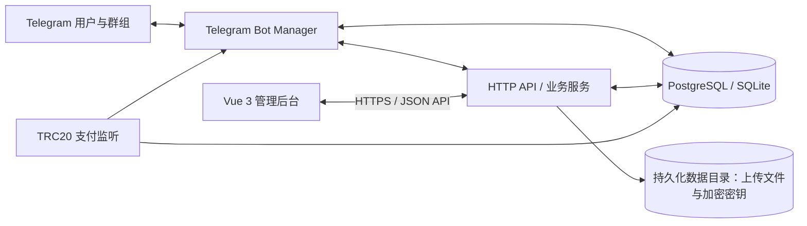

## 2026-11-21 — SMTP TLS 发送修复（PR #107 已合并并发布）

- 基线：main commit `84ead9a94505c1c0b9a9240b0748d9472dfdf048`；PR #107 已 Squash Merge，merge commit `ae6ff579b23ca8ebba71e535d4302acb8c6d666c`。
- 根因：站点设置保存了 `SMTPUseTLS`，但测试邮件、管理员邮箱验证码和业务邮件通知三条路径都没有读取该设置，仍直接调用旧 `smtp.SendMail`。
- 修复：新增统一 SMTP 发送器；465 使用隐式 TLS，其他支持 STARTTLS 的端口先协商 STARTTLS；启用 TLS 时服务器不提供加密能力则拒绝发送；SMTP 账号认证不允许走明文连接。三类邮件均复用该实现。
- 后台增加网易 `yeah.net` / `163.com`、QQ SMTP 主机、完整邮箱用户名和 SMTP 授权码提示。网易官方帮助资料确认 yeah.net 使用 `smtp.yeah.net`，推荐 465/SSL，且需开启客户端协议并使用授权码。参考：网易邮箱官方帮助中心（https://help.mail.163.com/）
- PR head Go Backend CI run `44892658871`、Admin Frontend CI run `44892658856`、Security Scan run `44892658941` 全部成功。合并后 main Go Backend CI run `44907751568`、Admin Frontend CI run `44907751716`、Security Scan run `44907751683`、Docker Publish run `44907751675` 全部成功；GHCR 镜像 manifest digest：`sha256:b8c84ea9241472750b6301e8f66cf3ead4aeb59862bc208bd620dad0173f9c1f`。
- 新增 SMTP TLS 行为测试；无数据库迁移、无新增环境变量。真实网易/QQ 邮箱验证码投递仍需部署后实发验收。
- 文档版本：2.2.62。

## 2026-11-21 — 登录双重验证按账户状态显示与 Cap 验证组件紧凑化（PR #105 已合并并发布）

- 基线：main commit `354f73499ce23cafee598e8ec66683e196993ee2`；PR #105 已 Squash Merge，merge commit `84ead9a94505c1c0b9a9240b0748d9472dfdf048`。
- 登录页不再默认显示动态验证码和恢复码字段。用户先提交用户名/密码，服务端仅在凭据正确后返回该账户是否启用了 TOTP；未启用时不显示二次验证字段，已启用时只显示一个字段，默认提示“已开启双重验证，请输入 6 位动态验证码”。
- 恢复码通过单独的“无法使用验证器？使用一次性恢复码”入口切换同一个输入框，不再与动态验证码同时占用页面空间；登录接口仍负责最终验证与一次性消费。
- Cap widget 使用官方支持的 CSS 自定义属性，将高度从默认约 58px 调整为 30px，并同步缩小内边距、间距和复选框；保持全宽，与账号/密码输入框左右对齐。
- 新增 TOTP 登录预检接口及后端测试；无数据库迁移、无新增环境变量。Cap 验证流程和 fail-closed 行为不变。
- 验证：PR head Go Backend CI run `44891533105`、Admin Frontend CI run `44891533058`、Security Scan run `44891533023` 全部成功；合并后 main Go Backend CI run `44891739024`、Admin Frontend CI run `44891739045`、Security Scan run `44891739012`、Docker Publish run `44891738972` 全部成功；镜像 digest `sha256:bf5a1ba71e51cfd9318e3feada105c3f741d90bb4d6bb52bd854d7f5968e71a3`。真实手机浏览器视觉验收待执行。
- 文档版本：2.2.62。

## 2026-11-21 — Owner Bot 媒体回复限制为单次 Telegram 副作用（PR #104 已合并；原 PR #77 已关闭并由 PR #104 替代）

- 原 PR #77 的分支基于旧 main，落后当前主线 23 个提交且与主线存在分叉；未直接合并旧分支。本次在最新 main 上重新应用并审查同一范围，避免把旧主线上的历史改动带入。
- 修复 Owner 媒体回复 caption 超过 900 个 Unicode 字符时先发送媒体、再发送剩余文字的双 API 副作用风险；现在超长 caption 在调用 sendPhoto/sendDocument 前拒绝，正常长度媒体只执行一次 Telegram 发送调用。
- 新增回归测试：超长 caption 只能向 Owner 发送拒绝提示，不得调用 sendPhoto/sendDocument，不得把未送达内容写入工单管理员回复时间线。
- 更新 `docs/support-tickets.md` 说明限制；无数据库迁移、无新增环境变量，不改变普通文本回复或用户提交媒体流程。
- PR #104 已 Squash Merge，merge commit `354f73499ce23cafee598e8ec66683e196993ee2`；真实 Telegram Owner 回复验收仍待项目所有者执行。
- 文档版本：2.2.59。

## 2026-11-21 — 备份恢复测试补充模拟 RPO/RTO 计时（PR #102 已合并并发布）

- PR #102 已 Squash Merge 至 main，merge commit `a3e26c5ea4402b6f79876c7aa5ac4f43fed6e337`；独立分支 `test/backup-restore-rpo-metrics`。
- 集成测试记录两项指标：模拟数据丢失时刻减去最近一次成功备份完成时刻，作为测试场景模拟 RPO；从恢复脚本开始到隔离 app 容器恢复 running 的耗时，作为容器启动 RTO。
- PR head Go Backend CI、Admin Frontend CI、Security Scan 全部成功；合并后 main Go Backend CI run `44889690716`、Admin Frontend CI run `44889690674`、Security Scan run `44889690676`、Docker Publish run `44889690723` 全部成功。
- GHCR `latest` 与 commit tag `a3e26c5ea4402b6f79876c7aa5ac4f43fed6e337` 已发布，OCI manifest digest：`sha256:aaba213e22f07fd64827ffd2046da4c69f14c1340df41616428c3cc7fbde4396`。
- 该 RTO 仅到隔离 app 容器 running，不等于应用健康就绪 RTO；模拟 RPO 仅反映 CI 人为构造的时间窗口，不代表生产备份频率或真实可接受数据丢失窗口。生产 PostgreSQL PITR/恢复演练、业务健康检查和生产 RPO/RTO 仍待单独执行。
- 无生产数据库迁移、无新增生产环境变量；不连接或修改生产 Compose project、数据库或 volumes。
- 文档版本：2.2.58。

## 2026-11-21 — P1 数据库备份/恢复隔离演练自动化（PR #101 已合并并发布）

- PR #101 已 Squash Merge 至 main，merge commit `bd1087fc92ea5dd0263ebaa62a6ea94cb8f12f6d`；独立分支 `test/isolated-backup-restore-p1`。
- 新增 `scripts/test-backup-restore.sh`：在独立 Docker Compose project、临时 PostgreSQL 16 容器和独立命名卷中调用正式备份/恢复脚本。
- 测试创建合成分类、商品、库存卡密、订单及站点设置记录，以及 JWT signing key、加密 key 和上传文件；备份后模拟订单状态污染、库存行丢失、设置被修改、密钥损坏和上传文件丢失，再恢复并断言订单/库存/设置/密钥/上传文件全部回到备份状态。
- PR head Go Backend CI、Admin Frontend CI、Security Scan 全部成功；合并后 main Go/Admin/Security CI 全部成功，Docker Publish（run `44886025299`）已成功；GHCR `latest` 与 commit tag `bd1087fc92ea5dd0263ebaa62a6ea94cb8f12f6d` manifest digest：`sha256:ee2c1611a8d7635fe9ae5c1ea5d504d33168e9c5a34ff819a71ed853fb5020b6`。测试实际通过并打印容器启动耗时；该值不是生产应用就绪 RTO。
- 无生产数据库迁移、无新增生产环境变量；不会连接或修改生产 Compose project、生产数据库或生产 volumes。
- 当前状态：代码已合并，Docker Publish 已成功；GHCR `latest` 与 commit tag `bd1087fc92ea5dd0263ebaa62a6ea94cb8f12f6d` manifest digest：`sha256:ee2c1611a8d7635fe9ae5c1ea5d504d33168e9c5a34ff819a71ed853fb5020b6`。真实生产恢复演练、业务健康检查和生产 RPO/RTO 仍待单独执行。
- 文档版本：2.2.56。

## 2026-11-21 — P1 管理员敏感操作二次确认（PR #100 已合并并发布）

- PR #100 已 Squash Merge 至 main，merge commit `50ecad1ca9fd72ec319e46b1d26fd659a3ad8f34`；开发分支 `feat/admin-sensitive-action-step-up-p1`。
- 新增迁移 `0057_admin_action_confirmations.sql`：数据库只保存一次性确认凭证 SHA-256 哈希；凭证有效期 2 分钟，绑定管理员、action key、HTTP method、精确路径和规范化请求体，并通过原子消费防止重放。
- 二次确认要求管理员当前密码；启用 TOTP 时还需动态验证码或一次性恢复码。覆盖余额调整、采购/退款/核实、支付人工核对、售后退款、订单恢复/清理及敏感配置更新。
- Admin UI 统一处理 HTTP 428 challenge，完成认证后重放原请求；恢复码如被使用则一次性消费。
- PR head Go Backend CI、Admin Frontend CI、Security Scan 全部通过；合并后 main Go Backend CI、Admin Frontend CI、Security Scan 全部通过。Docker Publish（run `44885024397`）已成功；GHCR `latest` 与 commit tag `50ecad1ca9fd72ec319e46b1d26fd659a3ad8f34` manifest digest：`sha256:1ef5ec7d1ef7cc75b9b764bcbea972b83687798468f705e0a4da3664704493a2`。生产部署与真实浏览器 step-up 验收仍待项目所有者执行。
- 真实浏览器端密码/TOTP/恢复码确认流程仍待部署验收；不能以 CI 通过代替生产验收。
- 文档版本：2.2.55。


## 2026-11-21 — 管理员登出即时撤销 Access Session（PR #99 已合并并发布）

- PR #99 已 Squash Merge 至 main，merge commit `cdba7015b67b87a29a30b1bad946c91ec7701bdd`；独立分支：`fix/admin-logout-revoke-access-session-p1`。
- 审查 PR #97 后发现 Vben Admin 上游 `logoutApi` 使用 `baseRequestClient`，只携带 HttpOnly refresh cookie，不携带 Authorization Bearer；服务端因此只能撤销 refresh family，当前浏览器的 access session 会在最多 15 分钟内继续有效。
- 新增 Vben auth API override，登出改用认证 `requestClient`，同时携带 Bearer 与 HttpOnly Cookie；新增 HTTP 回归测试验证登出后原 Bearer 立即返回 401。
- PR #99 Go/Admin/Security/Docker Publish 全部通过；GHCR manifest digest：`sha256:a425567f2d947a85aa5cb950974cc99e69420fe2f7a03f7b4eff0c780866bbe5`。无数据库迁移、无新增环境变量；真实浏览器登录/刷新/登出验收仍待部署后执行。
- 文档版本：2.2.53。

## 2026-11-21 — P1 管理员短效 Access Token 与轮换 Refresh Token（PR #97 已合并并发布）

- PR #97 已 Squash Merge 至 main，merge commit `6fda2ab7c18a8b0f90ace3c7da9672ab0a60bd27`；独立分支：`feat/admin-refresh-token-rotation-p1`。
- Access Token 缩短为 15 分钟；Refresh Token 有效期 7 天，通过 HttpOnly、SameSite=Lax Cookie（`/api/auth`）下发，不返回给前端 JS。
- 刷新接口与 Vben Admin 既有 `refreshTokenApi` 协议兼容；每次刷新轮换 refresh token，并在数据库仅存 SHA-256 token hash。
- 检测已撤销 refresh token 重放时，撤销整个 token family 并记录管理员审计与全局异常；密码/TOTP 状态变化通过 token_version 使旧 refresh session 失效。
- 登出可通过 HttpOnly refresh cookie 撤销会话族；新增迁移 `0056_admin_refresh_sessions.sql`，无新增环境变量。
- PR #97 Go/Admin/Security/Docker Publish 全部通过；GHCR manifest digest：`sha256:69947b55083b12bfe18e0952687ebab792ad1728493f394eb1ad6ec918c944f5`。SQLite 轮换/重放测试通过；PostgreSQL 专项测试在 CI 未配置 `TEST_POSTGRES_DSN` 时会跳过；真实浏览器刷新验收仍待执行。

## 2026-11-21 — P1 TOTP 一次性恢复码（PR #96 已合并）

- PR #96 已 Squash Merge 至 main，merge commit `45dda335062f5ae8a5b053f92b98588006a9ce3e`；独立分支：`feat/admin-totp-recovery-codes-p1`。
- PR #95 已提供 RFC 6238 管理员 TOTP、AES-GCM 加密密钥、绑定/关闭流程、登录校验与会话撤销；PR #95 Go/Admin/Security CI 全部通过并已合并。
- 本阶段补齐 10 个高熵一次性恢复码：仅在绑定确认时显示一次，数据库仅保存 SHA-256 哈希；消费采用 compare-and-swap 防并发复用，成功登录后审计；关闭 TOTP 同时清空恢复码。
- 新增迁移 `0055_admin_totp_recovery_codes.sql`，登录支持备用恢复码，安全设置页面一次性展示并提示安全保存。
- PR #96 Go/Admin/Security/Docker Publish 全部通过并已合并；GHCR manifest digest：`sha256:41c3c879a278a7aa442f45abd838abfb6fa82df718515a4ed2811d30d97a8758`。真实管理员绑定/恢复码登录验收仍待执行。

## 2026-11-21 — P1 管理员 TOTP 双重验证（PR #95 已合并）

- PR #95 已 Squash Merge 至 main，merge commit `902518c8e0cfbfddb83d3570206c34f3d69028fd`；独立分支：`feat/admin-totp-two-factor-p1`。
- 新增 RFC 6238 TOTP（6 位、30 秒周期、±1 时间步），启用需当前密码 + 验证器确认；已启用管理员登录需密码 + Cap（如启用）+ TOTP。
- TOTP 密钥使用现有 AES-GCM Secret Manager 加密存储；数据库只存密文，绑定采用 pending→confirm→enabled 状态转换；关闭需当前密码与 TOTP。
- 新增安全设置页面、登录动态码输入、独立限流和管理员审计；迁移 0054_admin_totp.sql，无新增环境变量。
- 后续 PR #96 补充一次性恢复码，生产启用前仍需完成真实管理员验证器绑定与恢复码登录验收。
- PR #95 Go/Admin/Security/Docker Publish 全部通过；GHCR manifest digest：`sha256:b51ec8ed881cf73d52e2038e6f68a3064b3c818b0e59132970df2339b77fa17a`。真实管理员绑定验收待完成。

## 2026-11-21 — P1 业务风险 Owner 主动告警（PR #94 已合并）

- PR #94 已 Squash Merge 至 main，merge commit `c02ad8fc2db50212affcfa948226dfb79f5b9ba7`；独立分支：`feat/business-owner-alert-thresholds-p1`。
- 新增每分钟业务告警巡检：最近三笔终态交付连续失败、退款账本冲突达到 3 笔、delivery/procurement uncertain 最久等待达到 15 分钟、Cap 连续失败 3 次、API P95 达到 1500ms（至少 20 个样本）、数据库连接池耗尽。
- 告警复用站点 `risk_alert` Telegram 配置，并通过 `finance_exception_alerts` 按告警类型/小时幂等去重；通知只含风险计数与处理提示。
- 不自动重发交付、不自动退款、不修改余额或采购状态；无数据库迁移、无新增环境变量/后台配置。
- PR head Go/Admin/Security CI 全部通过；合并后 main Go/Admin/Security/Docker Publish workflows 待最终确认。Owner 真实 Telegram 通知验收仍待执行。

## 2026-11-21 — P1 业务数据大盘与运行指标（PR #93 已合并）

- PR #93 已 Squash Merge 至 main，merge commit `bf4b5a1b36f780b5e0ca1c4695d5cbcb35f48c1f`；独立分支：`feat/business-metrics-dashboard-p1`。
- 新增受管理员鉴权保护的 `GET /api/dashboard/metrics`，返回 24 小时交付成功率、交付不确定数量与最久等待、退款账本冲突、上游同步进度、Cap 成功/失败计数、API P95 与数据库连接池状态。
- 经营概览改用聚合指标 API 展示上述指标；原机器人/商品/订单/售后基础卡片保留。
- 新增数据库聚合查询测试；指标只读，不修改订单、钱包、采购状态或异常状态。
- Cap 计数与 API P95 使用进程内窗口（Cap 自进程启动、API 最近 512 次请求），重启后重置；长期趋势与 Owner 告警阈值另列后续任务。
- 无数据库迁移、无新增环境变量/后台配置；PR #93 Go/Admin/Security CI 与合并后 Docker Publish run `44876350720` 全部成功。GHCR `latest` 与提交标签 `bf4b5a1b36f780b5e0ca1c4695d5cbcb35f48c1f` 已发布，manifest digest：`sha256:a4faef34507ff02cb73bf058f5261846d27714e9fa96456905413f6d5881da9c`。Cap 与 API 采样重启后重置，长期趋势未持久化。

## 2026-11-21 — P0-4 上游采购 uncertain 人工核实入口（PR #92 已合并）

- PR #92 已 Squash Merge 至 main，merge commit `d5b798785dcc614254acad56bbc1c482a207788e`；独立分支：`feat/upstream-uncertain-resolution-ui-p0-4`。
- 审计发现：后端已有 uncertain 采购人工核实接口，但上游设置页仍对 uncertain 订单展示直接重试/退款按钮，未提供 accepted / not_accepted 决策入口。
- 本次补齐 UI：uncertain 只展示“核实受理状态”；供应商确认已受理时登记上游订单 ID/订单号，恢复 polling 并只查单；确认未受理/明确失败时记录核实依据，收敛为 failed 后才开放安全重试/退款。
- 复用既有 `/api/upstream/procurements/{id}/resolve`，无新增 API、数据库迁移或环境变量；新增 not_accepted 状态回归测试，验证核实后可沿用原订单幂等键安全重试，且不创建退款流水。
- PR head Go/Admin/Security CI 全部通过；合并后 main Go/Admin/Security/Docker Publish run `44874512618` 全部成功。GHCR `latest` 与提交标签 `d5b798785dcc614254acad56bbc1c482a207788e` 已发布，manifest digest：`sha256:52fc62675515d150e3fdd1f12d72428099e0c60b36b3e3e4133676fa1551cf4c`。真实供应商核验流程仍需生产环境验收。

## 2026-11-21 — P0-4 不确定交付禁止盲目手动重试（PR #91 已合并）

- PR #91 已 Squash Merge 至 main，merge commit `ff1f2d5c31daa848fc4ee34548b8423e283684c0`；独立分支：`fix/block-uncertain-single-step-delivery-retry-p0-4`。
- 审计发现：自动恢复扫描虽排除 `delivery_uncertain`，管理员重试入口却只对 invite_link 与 file_card 做拦截，普通卡密、固定文本、上游内容等单步骤交付仍可直接重发。
- 修复：普通单步骤交付处于 `delivery_uncertain` 时，管理员入口明确拒绝重试；数据库 `ClaimOrderDelivery` 也仅允许 file_card 在存在步骤记录且不存在 uncertain/sending 步骤时恢复，防止绕过 HTTP 入口直接 claim。
- file_card 仍支持既有分步骤恢复：所有步骤经人工核实为 succeeded/failed 后，可跳过成功步骤，仅恢复失败步骤；缺失步骤证据或仍有不确定步骤时拒绝。
- 新增 SQLite/PostgreSQL 回归测试覆盖单步骤不确定订单拒绝手动 claim，以及 file_card 缺失/未核实步骤拒绝、全部核实后允许恢复。
- 无数据库迁移、无新增环境变量/后台配置；明确失败的 `delivery_failed` 重试流程不变。PR head Go/Admin/Security CI 全部通过；合并后 main Go/Admin/Security CI 与 Docker Publish run `44873878925` 全部成功。GHCR `latest` 与提交标签 `ff1f2d5c31daa848fc4ee34548b8423e283684c0` 已发布，manifest digest：`sha256:9034d2f3ecbad205291345e84e34f6c9c9e499c3022f68d615b3b1a705bccadf`。真实 Telegram 分步骤恢复仍待验收。

## 2026-11-21 — P0-4 上游采购不确定状态资金保护（PR #90 已合并并发布）

- PR #90 已 Squash Merge 至 main，merge commit `19ca3544baa4b79833b53cb56a65bf3c7007381c`；独立分支：`fix/block-uncertain-procurement-retry-p0-4`。
- 审计发现：采购请求网络超时/响应丢失后，系统将采购队列标记为 `uncertain`、订单标记为 `procurement_failed` 以进入人工队列；原手动重试和退款入口仍接受该组合状态。
- 风险：供应商可能已经受理并扣款；此时直接重试可能重复采购，直接退款可能造成供应商已履约且买家同时获退款。
- 修复：手动重试和钱包退款都只接受采购队列明确为 `failed` 的订单；`uncertain` 状态必须先由 Owner/管理员在供应商侧核实，确认未受理/失败后才可进入既有失败处理流程。
- 新增回归测试覆盖 uncertain 状态下重试、退款双双拒绝，并验证不会再次调用上游创建接口、不产生退款流水、不改变订单状态。
- 无数据库迁移、无环境变量/后台配置变化；旧 uncertain 订单升级后立即受到保护。回滚代码会重新开放此前的重复采购/重复退款风险，不建议回滚。
- PR head Go/Admin/Security CI 全部通过；合并后 main Go/Admin/Security CI 与 Docker Publish run `44873276614` 全部成功。GHCR `latest` 与提交标签 `19ca3544baa4b79833b53cb56a65bf3c7007381c` 已发布，manifest digest：`sha256:23a5aa26f511a5f07609a262d4c1e7a451e84c30a98e83041b61d66e26be109c`。生产部署与真实供应商核验流程仍待验收。

## 2026-11-21 — P0-4 阻止首次交付执行期间退款（PR #89 已合并并发布）

- PR #89 已 Squash Merge 至 main，merge commit `f3e09ba7637f683494a8675b3f7e928df59059b9`；独立分支 `fix/block-refund-during-active-delivery-p0-4e`。
- 审查发现 `RefundOrderToWallet` 虽与再次获取租约共享订单行锁，但仍允许 `orders.status='delivering'`，未将正在执行/尚未核实的首次交付排除在退款状态之外。
- 本分支将本地订单退款允许状态收紧为 `paid`、`delivery_failed`、`delivered`；`delivering`、`delivery_uncertain`、`refunded` 和其他状态均拒绝。这样退款与领取首次交付使用同一订单行并发仲裁，避免交付请求执行期间同时给买家入账。
- 新增 SQLite/PostgreSQL 共用回归测试：活动首次交付期间退款必须失败，订单保持 delivering，钱包余额与退款 credit 流水均不变。
- 不新增数据库迁移、环境变量或 API 参数；不改变已交付订单退款与已明确失败订单退款流程。
- PR head Go/Admin/Security CI 全部通过；合并后 main Go/Admin/Security CI 与 Docker Publish run `44872936750` 全部成功。GHCR `latest` 与提交标签 `f3e09ba7637f683494a8675b3f7e928df59059b9` 已发布，manifest digest：`sha256:ecbcb456eb6e2eb19057d3338b2705ac09e7d0e6a563a338096340eff6d71eb9`。生产部署和真实 Telegram 交付/退款并发验收仍需单独确认。

## 2026-11-21 — P0-4 上游退款生命周期孤立订单检测（PR #88 已合并）

- PR #88 已 Squash Merge，merge commit `4ee33774a6bc136f3360728a91a58d5dfd43f4eb`。
- 在只读退款完整性巡检中补充检测：来源快照为 upstream 且本地订单已退款，但缺少 `upstream_procurements` 生命周期记录时，登记 critical 财务异常。
- 新增 SQLite 回归测试；不补建采购行、不修改订单/钱包、不创建退款流水、不调用上游 API。
- 该项代码已合并；真实生产历史数据异常核查仍需部署后执行。

## 2026-11-21 — P0-4 退款状态一致性核对（PR #87 已合并）

- PR #87 已 Squash Merge，merge commit `ccb1803a6418a930c1cdf091607c41a31e508b07`。
- 退款完整性巡检除核验退款记录、钱包 credit、金额、买家与管理员关联外，新增核验 `orders.status` 与 `upstream_procurements.status` 是否同时为 `refunded`。
- 双向状态分裂按订单维度幂等登记 critical 财务异常；只报告、不自动修复，不改余额、流水或采购状态。
- PR #87 的实现已被后续 PR #88 扩展，生产异常数据核查仍待部署执行。

## 2026-11-21 — 订单与资金补偿机制 P0-4（PR #85–#86 已合并）

- PR #85 已合并，merge commit `1a6f05cde287ecfd5ac52a33e02698d70d75bc63`：定时恢复已付款、仍处于 `procurement_pending` 且缺失采购队列行的上游订单；沿用原始 `paid_at` 计算 deadline，以本地订单号唯一约束保证幂等，不修改支付信息、钱包余额或资金流水。
- PR #86 已合并，merge commit `3e2be62cef60553e92a92aea082d2470a51bf3e9`：Telegram 交付结果不确定时按订单唯一键认领一次 Owner 告警，复用 `risk_alert`，避免调度循环重复通知。
- 两项均不自动重试不确定交付、不自动退款、不自动调整余额；真实 Telegram 网络响应丢失和 Owner 通知仍需目标环境验收。

## 2026-11-21 — 分步骤交付状态机 P0-3（PR #84 已合并）

- PR #84 已 Squash Merge，merge commit `c56d6322a6a16bd5ce71977e52152a82eeb9d1c1`；新增迁移 `0053_order_delivery_steps.sql`，兼容 PostgreSQL/SQLite 并由应用启动自动迁移。
- `file_card` 文件发送与卡密消息分别持久化步骤状态、attempts、Telegram message_id、错误与时间；恢复时跳过成功步骤，只重试明确失败步骤。
- 发送结果不确定或崩溃遗留的 sending 步骤先转为 uncertain，必须人工核实并审计后才能恢复；发送期间订单租约阻止并发 claim/核实。
- PR #84 Go/Admin/Security CI 与 Docker Publish 已成功，镜像 digest：`sha256:50530060864b7ac04c8a5839e40b086e78049f3b7db4547103a2926eea001a75`。
- 代码已合并发布；真实 Telegram sendDocument/sendMessage 分步骤恢复仍待项目所有者验收。

## 2026-11-21 — Cap Widget 新版 CDN 加载兼容修复（PR #81 已合并）

- 状态：PR #81 已 Squash Merge 至 main，merge commit `791f3d43a623fdb3e59ba378626890083bf5aebd`。
- 登录页默认加载固定版本 `cap-widget@0.1.63` 的 jsDelivr CDN，不再依赖 Cap 服务的 `/assets/widget.js` 或「Widget files」开关；保留后端 `/{site-key}/siteverify` 一次性 Token 校验与 fail-closed 行为。
- 合并后 Admin Frontend CI（run `44833799359`）与 Docker Build and Publish（run `44833799370`）均成功。Docker job 的 Build and push 步骤成功；本记录不填写未经核验的 manifest digest。
- 真实 Cap 服务端到端验收待项目所有者执行。

## 2026-11-21 — Cap 自托管人机验证接入（PR #78 已合并并发布，文档版本 2.2.35）

- 状态：PR #78 已 Squash Merge 至 main，merge commit `8981fb887584979450f19b30648225ced113989d`；开发基线 main@a83f9bfa44989c55e4c6b9fd1aa4d4ed12ea1b81。
- 本次变更：后台 Cap 域名/Site Key/Secret Key 配置；Secret Key 使用现有 AES-256-GCM 密钥加密保存并脱敏读取；登录页加载自托管 `/assets/widget.js` widget；登录接口服务端调用 `/{site-key}/siteverify`，仅 success=true 放行。
- 数据库迁移：`0051_system_settings.sql` 创建兼容 PostgreSQL/SQLite 的 `settings(key,value,updated_at)` 表；Cap 配置保存在独立键值项，以支持终端 SQL 紧急关闭。
- 紧急关闭：`docker compose exec db psql -U tgcard -d tgcard -c "UPDATE settings SET value='false' WHERE key='cap_enabled';"`，随后 `docker compose restart app`；另支持 `DISABLE_CAP=true`，需 `docker compose up -d --force-recreate app` 让环境变量生效。
- 安全边界：后端 fail-closed；不向浏览器返回 Secret Key；验证请求 HTTPS、限制响应体和超时、禁止重定向，并拒绝 localhost/私有 IP 目标。当前仅覆盖管理员登录。
- PR head Go/Admin/Security 检查全部成功；合并后 main Go Backend CI #44828737475、Admin Frontend CI #44828737466、Security Scan #44828737403、Docker Publish #44828737396 全部成功。GHCR 多架构 `latest` 与提交标签 `8981fb887584979450f19b30648225ced113989d` 已发布，manifest digest：`sha256:e062f1dd8f77c4e3b515ded826668ad5fc89e344da429d59e102d7803a3587dc`。
- 真实 Cap 服务联调尚未执行；CI 通过不代表已在实际 Cap 域名完成浏览器挑战与登录验收。

## 2026-11-21 — 再次获取期间退款冲突审计与 HTTP 状态（PR #75 已合并并发布）

- PR #75 已 Squash Merge 至 main，merge commit `35e20d5810ce140e57c2dde96f9b0b4af4f10fc9`；审查基线 main@9abf51599e1c93d28c8cac30546e8ef5976bd653（PR #74 已合并并发布）。
- PR #74 已让退款与再次获取租约互斥；本轮补齐售后 API 行为：活动再次获取租约导致的退款拒绝返回 HTTP 409，并写入 `support.refund.blocked` 审计事件；其他退款失败记录 `support.refund.failed`。
- 使用数据库 sentinel error 区分可重试的租约冲突与其他退款失败，避免依赖错误文案字符串判断。
- 新增售后 API 回归测试，验证 HTTP 409、审计事件及订单/余额不变。PR head Go/Admin/Security 均成功；合并后 main Go #44814346690、Admin #44814346681、Security #44814346722、Docker Publish #44814346693 全部成功。GHCR 多架构 `latest` 与提交标签 `35e20d5810ce140e57c2dde96f9b0b4af4f10fc9` 已发布，manifest digest：`sha256:902cfecbc14e8d2d6eaed5c05ff1b01019343b4d456e1b24e17224e06b5a4dd8`。无数据库迁移或生产环境变量变更。
- 生产部署及真实售后退款验收仍需项目所有者确认。

## 2026-11-21 — 退款与订单再次获取租约互斥（PR #74 已合并并发布）

- PR #74 已 Squash Merge 至 main，merge commit `9abf51599e1c93d28c8cac30546e8ef5976bd653`；审查基线为 main@21cfd3ffc88606bc31ceb8c3a0bc3a77002cdbca（PR #73 已合并）。
- 发现管理员退款可与已交付订单的再次获取同时执行：退款事务锁定订单行，但再次获取租约原先在独立查询后写入另一张表；退款未检查活动再次获取租约，可能出现退款成功后仍继续发送商品的窗口。
- PR #74 已让退款与再次获取在同一订单行锁上串行化；活动再次获取租约期间拒绝退款，租约过期后可正常退款；退款完成后不再允许获取再次发送租约。
- 新增 SQLite/PostgreSQL 共用回归测试，验证活动租约阻止退款、租约过期后退款成功、退款订单不能重新获取租约。PR head Go #44812800729、Admin #44812800826、Security #44812800803 全部成功；合并后 main Go #44813061227、Admin #44813061231、Security #44813061385、Docker Publish #44813061197 全部成功。GHCR 多架构标签 `latest` 与提交标签 `9abf51599e1c93d28c8cac30546e8ef5976bd653` 已发布，manifest digest：`sha256:3392d6b4d4c2150bd95d06093082802865d02e86e017a060faa97bea46c1d0c0`。无数据库迁移或生产环境变量变更。
- 生产部署及真实退款/Telegram 再次获取验收仍需项目所有者执行。

## 2026-11-21 — PostgreSQL 再次获取租约并发回归（PR #73 已合并并发布）

- PR #73 已 Squash Merge 至 main，merge commit `21cfd3ffc88606bc31ceb8c3a0bc3a77002cdbca`。
- 新增 PostgreSQL 16 集成测试：8 个 worker 并发争抢同一 delivered 订单的再次获取租约时只能有一个成功；活动租约拒绝二次领取，过期租约可恢复。
- PR head Go #44811797126、Admin #44811797029、Security #44811796942 全部成功。
- 合并后 main Go [#44812154123](https://github.com/seanldnet/TG-Card/actions/runs/44812154123)、Admin [#44812154882](https://github.com/seanldnet/TG-Card/actions/runs/44812154882)、Security [#44812154255](https://github.com/seanldnet/TG-Card/actions/runs/44812154255) 与 Docker Publish [#44812154449](https://github.com/seanldnet/TG-Card/actions/runs/44812154449) 全部成功。GHCR 多架构标签 `latest` 与提交标签 `21cfd3ffc88606bc31ceb8c3a0bc3a77002cdbca` 已发布，manifest digest：`sha256:b52df6a6eff3b733f61501436cba25ea81ce083aa35561caca3d5fe586cc54b7`。
- 仅增加测试与文档，无运行时业务逻辑、数据库迁移或生产配置变化。

## 2026-11-21 — 已交付 file_card 再次获取防重复发送（PR #72 已合并并发布）

- PR #72 已 Squash Merge 至 main，merge commit `5d56777a3d24d5ff3e4afb0cfa746c3ac9ffea3b`。
- 已交付 `file_card` 的 Telegram sendDocument 与 sendMessage 是两个独立副作用；第二步失败后订单仍保持 delivered，整单再次获取可能重复发送文件。PR #72 在 Telegram 用户入口、Manager 与管理员 API 三层阻止此类自动重发，并引导联系客服人工核实；单步骤 card/file/fixed_text/upstream 保持既有再次获取行为。
- PR head `5c738a2977761c88e1b24aed28f3aa70406446a8` 的 Go CI [#44810969393](https://github.com/seanldnet/TG-Card/actions/runs/44810969393)、Admin CI [#44810969458](https://github.com/seanldnet/TG-Card/actions/runs/44810969458)、Security [#44810969354](https://github.com/seanldnet/TG-Card/actions/runs/44810969354) 全部成功。
- 合并后 main Go CI [#44811290066](https://github.com/seanldnet/TG-Card/actions/runs/44811290066)、Admin CI [#44811290206](https://github.com/seanldnet/TG-Card/actions/runs/44811290206)、Security [#44811290095](https://github.com/seanldnet/TG-Card/actions/runs/44811290095) 与 Docker Publish [#44811290150](https://github.com/seanldnet/TG-Card/actions/runs/44811290150) 全部成功。GHCR 多架构标签 `latest` 与提交标签 `5d56777a3d24d5ff3e4afb0cfa746c3ac9ffea3b` 已发布，manifest digest：`sha256:e4bcea3b8d21090ce5d976368bd2996129ad36c50d02edcfc0771d78f09038ba`。
- 无数据库迁移或生产环境变量变更。此保护为保守的整单隔离，不提供分步骤续发；生产部署与 Telegram 真机验收仍需项目所有者确认。

## 2026-11-21 — 多步骤交付不确定结果禁止整单重试（PR #71 已合并并发布）

- PR #71 已 Squash Merge 至 main，merge commit `cdb30cef99f27e3021de35fe1717937becc116c5`；main 当前基线已更新。
- 修复 `file_card` 首次交付多步骤风险：文件与卡密消息分别调用 Telegram API；前一步已成功、后一步结果不确定时，禁止对 `delivery_uncertain` 订单整单重试；保留 `invite_link` 一次性邀请链接保护。
- PR head `4d19643f369566397375682cca7cc747e47aacc7` 的 Go CI #44809724292、Admin CI #44809724257、Security #44809724481 全部成功。
- 合并后 main Go CI [#44810140754](https://github.com/seanldnet/TG-Card/actions/runs/44810140754)、Admin CI [#44810140828](https://github.com/seanldnet/TG-Card/actions/runs/44810140828)、Security [#44810140787](https://github.com/seanldnet/TG-Card/actions/runs/44810140787) 与 Docker Publish [#44810140725](https://github.com/seanldnet/TG-Card/actions/runs/44810140725) 全部成功。GHCR 多架构镜像标签 `latest` 与提交标签 `cdb30cef99f27e3021de35fe1717937becc116c5` 已发布，manifest digest：`sha256:926ee2f545d6c26580a0d453eefdb0df3ba97a4271b09c5505eb078603f0b63d`。
- 无数据库迁移或生产环境变量变更。保守隔离不提供分段自动续发；生产部署与 Telegram 真机验收仍需项目所有者确认。

## 2026-11-21 — 一次性邀请链接不确定结果禁止自动重试（PR #70 已合并并发布）

- PR #70 已 Squash Merge 至 main，merge commit `d7cf00e783c3e97b2ecee77d329488e3091a220c`。
- Telegram `createChatInviteLink` 可能已创建有效链接但响应丢失或本地持久化失败；API 与 Manager 双重阻止 `delivery_uncertain` 的 `invite_link` 重试，管理员列表隐藏重试并显示“需人工核实”，API 拒绝操作写审计。
- PR head Go CI、Admin CI、Security 通过；合并后 main Go CI #44804736581、Admin CI #44804736573、Security #44804736340、Docker Publish #44804736390 全部成功。
- GHCR 多架构镜像已发布，manifest digest：`sha256:1c2a7df3ace81cd4af6162ff2501892922508df611ad9e7699f2acf9318b059a`；生产部署与 Telegram 真机验收仍需项目所有者确认。

## 2026-11-21 — Telegram 订单交付不确定结果隔离（PR #69 已合并并发布）

- PR #69 已 Squash Merge 至 main，merge commit 1325e52443c0f06d52d21205c2e29af5fca39b70。
- Telegram sendMessage/sendDocument 等外部请求前持久化 delivery_uncertain 和 order_delivery_events；网络响应不确定或进程在外部副作用窗口崩溃时，后台 worker 不自动重发。成功发送后订单可收敛为 delivered。
- 管理员订单页显示“发货结果待核实”，确认后可通过单笔租约入口手动处理；纯本地校验/解密错误仍走 delivery_failed 指数退避。
- PR head Go/Admin/Security 全部通过；合并后 main Go CI、Admin CI、Security、Docker Publish 全部成功。
- GHCR latest 与提交标签 1325e52443c0f06d52d21205c2e29af5fca39b70 已发布；manifest digest：sha256:48e900b0a06a4e346eb36a5fc9cd51834041df0a8abb4442908d962e1a947a6f。
- 生产部署及 Telegram 真机验收仍需项目所有者确认。
## 2026-11-21 — 订单交付失败指数退避（PR #67 已合并并发布）

- PR #67 已 Squash Merge 至 main，merge commit `c460706a1cc7675cfbd9f274a9311f3f2654f468`。
- 后台自动交付 worker 对 `delivery_failed` 订单增加指数退避：第 1–6 次失败后的等待依次为 15、30、60、120、240、480 秒，之后封顶 900 秒；避免每 15 秒固定重试造成 Telegram API 无效请求与日志噪声。
- 首次已付款订单仍立即进入交付队列；租约过期的 `delivering` 订单仍可恢复；管理员手动补发使用单笔租约入口，不受后台自动重试退避限制。
- SQLite 与 PostgreSQL 16 均有测试覆盖退避时序和手动补发旁路；Go CI（vet/test/build）、Admin CI、Security 均成功；无数据库迁移或新增生产环境变量。
- 合并后 main Go CI #44784753138、Admin CI #44784752882、Security #44784753131、Docker Publish #44784753246 全部成功。
- GHCR 多架构镜像标签 `latest` 与提交标签 `c460706a1cc7675cfbd9f274a9311f3f2654f468` 已发布；manifest digest `sha256:7c5710db0edf473ca828022030f9b3904ad871e32316cb728ae15222648443eb`。
- 生产服务器是否已拉取部署该 digest，仍需项目所有者确认。

## 2026-11-21 — PostgreSQL 订单退款并发幂等验证（PR #65 已合并）

- PR #65 已 Squash Merge 至 main，merge commit `7e2d1f843bbe77bad92252d61b77b6716393dd2f`。
- 新增 PostgreSQL 16 集成测试：多个 worker 并发对同一笔已付款订单执行钱包退款，必须且仅有一次成功；钱包余额仅增加一笔，退款账本仅写入一条记录，订单最终状态为 `refunded`，后续重复退款被拒绝。
- PR head Go CI（含 PostgreSQL 并发退款测试）、Admin CI、Security 全部成功；仅增加测试与文档，不改变退款业务逻辑、数据库迁移或生产配置。
- PR #65 合并后的 main Go CI #44783008576、Admin CI #44783008481、Security #44783008445、Docker Publish #44783008524 已触发；截至本次文档更新，Admin/Security 成功，Go/Publish 仍在运行。
- 生产部署及真实退款操作验收仍需项目所有者确认。

## 2026-11-21 — PostgreSQL 订单交付租约并发验证（PR #64 已合并并发布）

- PR #64 已 Squash Merge 至 main，merge commit `1d88c5499d5ca87352391e051fd272cf2772f068`。
- PostgreSQL 16 集成测试验证同一已付款订单的多个 worker 并发争抢即时交付租约时只能有一个 worker 获胜；批量 worker 并发领取时必须领取不同订单。
- PR head Go CI（含 PostgreSQL 测试）、Admin CI、Security 全部成功；该 PR 只增加测试，不修改订单状态机、租约算法、数据库迁移或生产配置。
- 合并后 main Go CI #44782049335、Admin CI #44782049138、Security #44782049101、Docker Publish #44782049176 全部成功。
- GHCR 多架构镜像标签 `latest` 与提交标签 `1d88c5499d5ca87352391e051fd272cf2772f068` 已发布；manifest digest `sha256:a6378128ff6c184dce3c22337df9b4c061f76547fd1d66974f13799d2496570e`。
- 生产服务器是否已部署该 digest、Telegram 真机交付仍需项目所有者确认。

## 2026-11-20 — PostgreSQL 购物车并发验收补强（PR #62 已合并）

- PR #62 已 Squash Merge 至 main，merge commit `d988c6a554392af86ea03b9ba60297e1debab011`。
- Go CI（含 PostgreSQL 16 service 与双用户争抢最后一张卡密集成测试）、Admin CI、Security 在 PR 最新 head `50e2136884fdb5bffe0f0e989762f8c973a6c9b9` 均成功。
- 集成测试断言两个独立 Bot/Telegram 用户同时 checkout 时只能有一个成功预留库存；成功方只占用一张卡密，失败方购物车保留。PR 不修改运行时业务逻辑、数据库迁移或生产环境变量。
- main 合并后的 Go CI #44641444572、Admin CI #44641444462、Security #44641444408、Docker Publish #44641444376 已触发；截至本次文档更新，Go/Admin/Publish 仍在运行，Security 已成功。镜像 digest 待 Publish 成功后补录。
- 生产服务器是否已拉取/部署镜像、Telegram 私聊/群聊、余额付款、TRC20 付款和真实交付仍需项目所有者执行；CI/镜像发布不等于生产部署或真机验收。

## 2026-11-20 — main 合并与镜像发布基线校准（文档版本 2.2.19）

- 当前源码基线：main@59337349d36937a467e673e427f571ec276c17ce。PR #60 文档基线校准已合并（69ccab358c1bfefcf5ba79fcb04df5d9b17f48c1）；PR #61 Telegram 购物车与统一结算已合并（59337349d36937a467e673e427f571ec276c17ce）。
- PR #59 旧分支已关闭并由 PR #61 替代；购物车迁移 0049/0050、Bot 菜单/交互、单笔订单和分组卡密交付现已进入 main。Telegram 私聊/群聊、余额付款、TRC20 付款与真实交付验收仍需项目所有者执行。
- PR #61 head Go/Admin/Security 检查全部成功；合并后 main Go CI [#44636933083](https://github.com/seanldnet/TG-Card/actions/runs/44636933083)、Admin CI [#44636932944](https://github.com/seanldnet/TG-Card/actions/runs/44636932944)、Security [#44636932940](https://github.com/seanldnet/TG-Card/actions/runs/44636932940)、Docker Publish [#44636932941](https://github.com/seanldnet/TG-Card/actions/runs/44636932941) 全部成功。
- GHCR 多架构镜像已发布：ghcr.io/seanldnet/tg-card:latest 与固定提交标签 59337349d36937a467e673e427f571ec276c17ce；manifest digest 为 sha256:09f9b2c7ee23037ad9c03e26d1b490bdb853988958e6e7804e224bc855039f7d。生产服务器是否已拉取/部署该镜像未由 CI 证明。
- PR #62 PostgreSQL 并发集成测试仍在开发：Go CI 增加临时 PostgreSQL 16 服务，验证两个独立 Bot/用户争抢同一件卡密时只允许一个结算成功，失败方购物车保留。CI 验证完成前不合并。
- 数据库影响：PR #61 新增迁移 0049/0050，随应用启动自动执行；PR #62 不新增迁移、不改运行时逻辑、不增加生产环境变量或手工 SQL。
- 专项文档边界保持：PR E 真实商户联调未执行；Owner C1–C4、生产部署和真实 Telegram 验收分别跟踪，不以 CI 或镜像发布代替。

> **文档元信息**
> - 最后更新时间：2026-11-21
> - 文档版本：2.2.60
> - 源码核对基线：main 分支，commit `354f73499ce23cafee598e8ec66683e196993ee2`；PR #104 已合并
> - 本次文档更新：记录 PR #104 合并及登录双重验证/Cap 组件优化；基线为 main@354f734
>

## 2026-11-20 — 上游同步性能与售卖来源总闸（PR U #56 已合并并发布）

- 独立分支：`feat/upstream-sync-performance-source-switch-pr-u`；PR #56 已 Squash Merge：https://github.com/seanldnet/TG-Card/pull/56。基线为 main 的 `6f7e80ec14407cac7fee0bb4559e9084af8253ad`，合并提交 `b5ada0116fe4c33e0a4207ebb754715834e909d8`。

- 已写入分支的实现：Dujiao 商品分页拉取（后台可配置 20–50 条/批、250–10000ms 间隔，默认 25/1000ms）；每批独立数据库事务；商品/分类指纹包含上游目录字段及本地加价/汇率策略；未变化商品/分类只标记本轮已见，跳过 SKU 重写和图片下载。
- 同步入口改为后台任务：手动与定时同步共用任务锁；数据库唯一活动任务索引阻止多实例重复执行；持久化进度、批次、错误数和取消请求；单页最多重试 3 次，失败页记录后继续扫描，连续 3 页失败暂停并通知 Owner；取消保留已提交批次且不执行缺失商品下架收尾。进程重启时将未结束任务标记为 interrupted/failed。
- 目录写入在同步期间标记 stale，使 Bot 暂时只展示本地目录，避免向用户暴露新旧混合的上游目录；全量页成功后统一执行缺失商品/分类收尾，再恢复上游来源。
- Bot 商城改为来源过滤后的数据库分页：分类页每屏最多 5 个分类按钮并提供翻页；分类商品每屏最多 5 个并显示价格/库存；商品详情按 ID 单条读取；搜索限制为 7 条结果；Owner 商品列表限制为 50 条。上游 auto 履约商品可进入正常订单/付款/采购队列，manual 履约不开放自助购买；真实供应商联调仍待 PR E。
- 停用上游改为单独二次确认流程：先将目录标记 stale、切回本地售卖，再按分类→商品/SKU→图片清理；只删除 `source_type='upstream'` 数据；若发现上游商品关联本地卡密库存则中止清理防止级联丢失；图片只处理上游专属目录中的 hash 文件，并检查本地记录引用；历史订单依靠 `ON DELETE SET NULL` 与订单名称/价格快照保留。清理完成才把 `enabled` 置为 false；失败保持本地售卖并允许重试；完成写审计数量并通知 Owner。
- 新增迁移：`0044_upstream_sync_jobs.sql`、`0045_upstream_sync_batch_config.sql`、`0046_upstream_product_fingerprint.sql`、`0047_upstream_sync_single_active_job.sql`、`0048_upstream_category_fingerprint.sql`。
- 官方协议限制：商品接口支持 page/page_size（官方上限 100）并返回 updated_at；官方未提供 updated_since；分类接口文档没有分页与更新时间字段。因此当前“增量”是分页扫描后按稳定指纹只处理变化商品/分类，不声称减少上游分页请求。
- 当前状态：PR #56 已 Squash Merge，merge commit `b5ada0116fe4c33e0a4207ebb754715834e909d8`；main Go CI #44600428873、Admin CI #44600428589、Security #44600428737、Docker Publish #44600428987 全部成功。GHCR 多架构 latest digest `sha256:b92a802644f3fa6a834edf7e7e6d480cdd97419f60242bad3ed63358356afb58`。生产部署与真实压力验收待项目所有者执行。
- 验收仍需项目所有者执行：数千商品同步期间资源占用与 Bot 响应；进度/取消；启用只展示上游；停用后目录与图片清理、历史订单保留。本 PR 未进入 PR S/PR E。

## 2026-11-20 — 管理员登出撤销当前 Bearer 会话（PR #53 已合并）

- 审查发现 `POST /api/auth/logout` 原先只返回成功，不撤销服务端 JWT；复制出的旧 Bearer token 在 24 小时有效期内仍可继续调用 API。
- PR #53 新增管理员 Token 会话表，数据库仅保存 Bearer token 的 SHA-256 摘要及管理员 ID/过期时间，不保存原始 token。
- 每次签发生成独立随机 JTI，避免同一秒内重复登录产生相同 token；登录成功后登记当前 token；所有鉴权请求同时检查签名、管理员状态/TokenVersion 与服务端会话记录；登出只撤销当前设备 token，不影响同一管理员的其他有效登录。
- 新增 SQLite/PostgreSQL 兼容迁移 `0041_admin_token_sessions.sql`、会话生命周期测试及登录→登出→旧 token 拒绝/另一设备 token 保持有效的集成测试。
- 迁移上线后，部署前签发的旧 token 不在新会话表中，将要求管理员重新登录；密码修改仍通过 TokenVersion 撤销全部旧会话。
- PR #53 已合并至 main，merge commit `8260a9c4775726587c33100c939eb78018de8cb3`；PR head Go/Admin/Security 全部成功。main Go CI [#44579627983](https://github.com/seanldnet/TG-Card/actions/runs/44579627983)、Admin CI [#44579627988](https://github.com/seanldnet/TG-Card/actions/runs/44579627988)、Security [#44579628087](https://github.com/seanldnet/TG-Card/actions/runs/44579628087)、Docker Publish [#44579628246](https://github.com/seanldnet/TG-Card/actions/runs/44579628246) 全部成功；GHCR 多架构 latest manifest digest 为 `sha256:7c14fabea0d23e7903785237052fa69fc1144a8d7be263c420373555131c5e37`。

## 2026-11-20 — Owner Bot 重启恢复、超时与工单切换回归（PR #50 已合并）

- 补强 C3/C4 自动化覆盖：模拟 Manager 重建后从数据库恢复 Owner reply 会话并成功发送；验证 30 分钟 TTL 过期后新消息不会被消费、不会发送或写入客服时间线。
- 验证 Owner 从工单 A 切换到工单 B 后，A 的旧确认按钮不能结单 A，也不能覆盖 B 的当前 reply 会话。
- 本批次仅增加测试，不改变业务行为、数据库结构或部署配置。PR #50 head Go/Admin/Security 全部成功；合并后 main Go CI [#44577264757](https://github.com/seanldnet/TG-Card/actions/runs/44577264757)、Admin CI [#44577264448](https://github.com/seanldnet/TG-Card/actions/runs/44577264448)、Security [#44577264428](https://github.com/seanldnet/TG-Card/actions/runs/44577264428)、Docker Publish [#44577264695](https://github.com/seanldnet/TG-Card/actions/runs/44577264695) 全部成功；GHCR 多架构 latest manifest digest 为 `sha256:eb0776f9dafc7d90aa1928a9f85eeeaf1488891c16ab843826aa0db9ab2a1a4e`。真实 Telegram C3/C4 仍需项目所有者实测。

## 2026-11-20 — Owner Bot 继续沟通与媒体回复回归覆盖（PR #47 已合并）

- 在 PR #44 会话隔离修复基础上补齐 C1/C2 自动化回归：验证 Owner 点击“否，继续沟通”后会话恢复 reply 阶段；不再点击按钮直接连续发送两条消息时，两条回复均成功送达并写入时间线。
- 新增图片与普通文件回复测试，验证图片使用 Telegram `sendPhoto`、文件使用 `sendDocument`，且 Telegram 确认成功后才保存对应附件时间线记录。
- 本批次仅增加测试，不改变业务行为、数据库结构或部署配置。PR #47 head Go/Admin/Security 全部成功；合并后 main Go CI [#44575485326](https://github.com/seanldnet/TG-Card/actions/runs/44575485326)、Admin CI [#44575484730](https://github.com/seanldnet/TG-Card/actions/runs/44575484730)、Security [#44575484649](https://github.com/seanldnet/TG-Card/actions/runs/44575484649)、Docker Publish [#44575484792](https://github.com/seanldnet/TG-Card/actions/runs/44575484792) 全部成功；GHCR 多架构 latest manifest digest 为 `sha256:3b763b2410a222c62ed864685ac2cba06c86fbc3942c69aa429d9b702cb02368`。真实 Telegram C1/C2 仍需项目所有者实测。

## 2026-11-20 — Owner 工单确认回调会话隔离加固（PR #44 已合并）

- 已合并至 main，merge commit `0c705ed99c76488aeafa273b019fb3262d19d398`。
- 确认回调必须匹配当前 Bot、Owner、Telegram chat_id、ticket_id 与 `confirm` 阶段；Owner 切换工单、会话过期/清理或使用旧按钮时拒绝操作，不变更错误工单。
- Owner 回复会话绑定发起“开始回复”时的 Telegram chat_id；从其他群聊或私聊发来的消息不会命中当前工单会话。
- 新增迁移 `0040_support_owner_session_chat.sql`，为持久化会话增加 chat_id；升级时清理无法安全关联 chat_id 的旧会话，Owner 重新点击“开始回复”即可。30 分钟 TTL、数据库持久化与 Bot 重启恢复保持不变。
- “开始回复”现在检查工单状态更新结果；“否，继续沟通”检查会话写入结果。
- 新增双工单旧按钮隔离、重复回调审计幂等、跨 Telegram chat 会话隔离回归测试。
- PR head Go/Admin/Security 全部成功；Go CI [#44573219338](https://github.com/seanldnet/TG-Card/actions/runs/44573219338)、Admin CI [#44573220790](https://github.com/seanldnet/TG-Card/actions/runs/44573220790)、Security [#44573219439](https://github.com/seanldnet/TG-Card/actions/runs/44573219439)。
- main Security [#44573663686](https://github.com/seanldnet/TG-Card/actions/runs/44573663686) 已成功；main Go CI [#44573663656](https://github.com/seanldnet/TG-Card/actions/runs/44573663656)、Admin CI [#44573663564](https://github.com/seanldnet/TG-Card/actions/runs/44573663564)、Security [#44573663686](https://github.com/seanldnet/TG-Card/actions/runs/44573663686) 全部成功；Docker Publish [#44573663703](https://github.com/seanldnet/TG-Card/actions/runs/44573663703) 成功，GHCR 多架构 latest manifest digest 为 `sha256:64cbbf218f0aff25d0eddf6e784929a134596f1ae7c85b13bec48ba89cf5d1fe`。
- 生产部署与 Telegram C1–C4 真机验收未确认；不把 CI 结果视为生产验收。

## 2026-11-20 — 网页后台客服回复送达一致性修复（PR #42 已合并）

- 已合并至 main，merge commit `7fd658d1803d18442d9284098ddf8128cf22cc19`。
- 网页后台文本客服回复改为先发送 Telegram，明确成功后才写入 admin 时间线并更新工单回复字段；明确发送失败仅记录 system 事件，工单状态/回复字段不变并返回 502。前端改为先提交回复、成功后再更新工单状态。
- 新增成功/失败回归测试；PR head Go CI、Admin CI、Security 均成功；main Go CI、Admin CI、Security 均成功。
- main Go CI [#44570069329](https://github.com/seanldnet/TG-Card/actions/runs/44570069329)、Admin CI [#44570069285](https://github.com/seanldnet/TG-Card/actions/runs/44570069285)、Security [#44570069428](https://github.com/seanldnet/TG-Card/actions/runs/44570069428) 均成功。Docker Publish [#44570069465](https://github.com/seanldnet/TG-Card/actions/runs/44570069465) 已成功，GHCR 多架构 latest manifest digest 为 `sha256:025a45cccf1895c17882e863b15bb524adc83200b2a7b77b891cee9e75a9182d`。
- 生产部署及 Telegram 真机验收未确认；Telegram 无业务消息幂等键，网络超时/响应丢失仍不能保证 exactly-once。

## 2026-11-20 — Owner 回复发送状态一致性修复（PR #41 已合并）

- 修复已合并至 main，merge commit `af53dad378bb8d1d89385246bd7d11a308e8b7e0`。
- Owner 回复先发送 Telegram，确认成功后才写入客服时间线并切换至待结单确认阶段；发送失败只写系统失败事件并保留回复会话。
- PR head Go/Admin/Security 与 main Go/Admin/Security/Docker Publish 均成功；Docker Publish Run [#44567512730](https://github.com/seanldnet/TG-Card/actions/runs/44567512730) 成功。该轮 GHCR digest 尚未独立核实，生产部署与 Telegram 真机验收未确认。
- Telegram 无业务消息幂等键；超时/响应丢失的远端送达状态仍不确定，不能宣称 exactly-once。

## 2026-11-20 — 售后 Owner Bot 工单列表跨 Bot 隔离修复（PR #40 已合并）

- 修复已合并至 main，merge commit `69218784601f7d75b668b8047379d931c9a87564`。
- PR head Go/Admin/Security 与 main Go/Admin/Security/Docker Publish 全部成功。
- GHCR `latest` 镜像 digest：`sha256:0a0ca07e37b42b46b6c6bfb6cc6a2519348066fc6ae62bf98eb4c5b09134b2d7`；Publish Run [#44565112822](https://github.com/seanldnet/TG-Card/actions/runs/44565112822)。生产部署与现场验收仍未确认。

## 2026-11-20 — 阶段一售后媒体转发子项按项目所有者实测确认

- 项目所有者明确确认：用户提交的图片/文件由对应 Bot 转发至 Owner 私聊并收到原始媒体，媒体转发子项实测通过。
- 验收边界：未提供本次测试使用的镜像 digest、测试设备、订单/工单号或截图；不将此结果绑定到 PR #38 镜像，也不补造证据。
- 仍待验收：Owner C1–C4 真实 Telegram 流程、完整菜单/按钮、补发/退款各状态分支，以及跟踪防护下静态资源零外部 CDN Network 检查。自动化测试通过不能替代这些真机/浏览器验收。
- PR #38（PR D）已合并并成功发布 GHCR，merge commit `935bd222977b1a636c5f05ab4faebdc3e835dda1`，digest `sha256:691493ce844c96a504785e0fb72b24534786f57279190322332f45b5ba8b7b29`；生产部署与该 digest 的生产验收未确认。PR E 真实商户联调未开始。

# TG-Card 项目现状与功能总览

> 本文是项目当前实现状态的主文档。内容以 `main` 分支源码、数据库迁移、后台页面和现有技术文档为依据；产品规划不等于已交付功能。每次开发、修复、重构或发布都必须同步更新本文和 `docs/CHANGELOG.md`。

> **文档元信息**
> - 最后更新时间：2026-11-21
> - 文档版本：2.2.64
> - 源码核对基线：`main@a4600b895ae8fea60d646e104fb4045003de0b0b`；PR #109 文档基线校准已合并
> - 本次文档更新：校准 P0-3/P0-4 的 PR #84–#89 合并状态、CI/发布边界及文档版本

- 项目：TG-Card
- 仓库：https://github.com/seanldnet/TG-Card
- 默认分支：`main`
- 文档维护原则：代码是事实来源；无法从代码或测试确认的功能，不得标记为“已完成”。
- 状态定义：
  - **已实现**：代码中存在完整主要路径或后台/API入口。
  - **部分实现**：已有可用基础路径，但仍有明确限制。
  - **待开发**：只有规划、占位或尚无完整实现。
  - **待验收**：代码已提交或合并，但尚未完成目标环境端到端验证。

## 1. 产品定位与边界

TG-Card 是**单商户、多 Telegram Bot 的自动发卡商城**。多个 Bot 共用同一套商品、库存、用户、订单、支付和售后数据；Bot 负责用户交互与交付，网页管理后台负责完整配置。

当前产品边界：
- 单商户、单管理员后台，不是多租户 SaaS。
- 不包含代理商、代理余额、分销佣金体系。
- 多个 Bot 共用商品与订单核心，但可分别配置 Bot Token、欢迎内容、购买须知、介绍、Owner 和客服/群组链接。
- 管理后台是商品、库存、订单、支付设置及运营数据的主要管理入口。

## 2. 技术架构

| 层 | 当前实现 |
|---|---|
| 后端 | Go HTTP API，入口 `cmd/server` |
| 前端 | Vue 3 + TypeScript + Vite + Ant Design Vue，基于 Vue Vben Admin 5.x |
| 前端定制 | `web/overrides/`；上游 Vben 通过 Git Submodule 固定版本 |
| 数据库 | Docker 默认 PostgreSQL 16；独立运行支持 SQLite / PostgreSQL |
| 数据迁移 | `internal/database/migrations/*.sql`，启动时自动执行版本迁移 |
| Telegram | 自建 Bot Manager，使用 Telegram Bot API 长轮询接收消息及回调 |
| 敏感数据 | 应用数据目录中的持久化密钥；Bot Token、支付 API Key 等加密保存 |
| 部署 | Docker Compose + GHCR 预构建镜像，支持 linux/amd64、linux/arm64 |
| CI | Go CI、Admin 前端 CI、安全扫描、Docker 镜像构建发布 |

主要目录：
- `cmd/server/`：HTTP 服务、API 路由、支付/订单/售后管理逻辑。
- `internal/telegrambot/`：Bot 运行时、用户菜单、回调、发货、广播与定时任务。
- `internal/database/`：数据库访问、事务、订单/库存/余额/营销/工单操作。
- `internal/payment/`、`internal/tron/`：支付监听与 TRON 链上交互。
- `web/overrides/apps/web-antd/src/views/`：后台业务页面。
- `docs/`：产品范围、支付交付、售后及开发变更记录。



图示为逻辑关系：Bot Manager 与 HTTP API 共用数据库；支付监听将链上交易写入数据库并在支付确认后触发 Bot 发货；管理后台通过 HTTP API 管理业务数据。部署时是否启用 HTTPS 取决于外部反向代理配置。

## 3. 当前后台页面与功能清单

以下状态描述的是当前仓库可见实现，不代表每个场景都已经过生产环境验收。

| 模块 | 状态 | 当前能力与边界 |
|---|---|---|
| 登录与管理员资料 | 已实现 | 管理员登录、Bearer Token、密码修改、个人资料、头像、邮箱验证码相关接口；密码 bcrypt 哈希。 |
| 仪表盘 | 部分实现 | 提供工作台/分析页面；具体指标以页面和 API 实际返回为准，不应把规划中的全部经营指标视为已交付。 |
| 机器人管理 | 已实现 | 添加/编辑/删除 Bot、Token 验证与加密保存、启停、欢迎内容、购买须知、介绍、Owner ID、客服/群组链接、运行状态、单 Bot 重启。 |
| 商品与分类 | 已实现 | 分类管理、商品增删改、上下架、商品信息、价格及交付配置、库存卡密导入。 |
| 购物车与多商品统一结算 | 已实现（PR #61 已合并，真机待验收） | main 已包含迁移 0049/0050、按 Bot/用户隔离的购物车、单笔多商品订单、库存事务预留、余额/TRC20 付款复用和逐商品卡密交付；仅本地 USDT card/file_card 商品可统一结算。Telegram 真机验收待项目所有者执行。 |
| 订单管理 | 已实现（交付安全持续加固） | 订单列表、订单详情、支付状态与交付状态查看、清理入口、管理员重试发货；列表分页。PR #71 已阻止不确定 file_card 整单重试；PR #72 已阻止已交付 file_card 自动再次获取。 |
| 支付流水 | 已实现 | 链上交易列表、状态筛选/搜索、已匹配/未匹配/需人工核对状态、人工匹配订单及备注。 |
| 支付设置 | 已实现 | 后台设置 TRON 收款地址、TronGrid API Key、USDT 合约及启停；API Key 加密存储、脱敏显示，保存后更新运行配置。 |
| 优惠券/促销 | 已实现 | 促销规则的查询、创建/更新、删除；具体类型与适用规则以当前页面/API为准。 |
| 兑换码 | 已实现 | 兑换码规则的创建/更新/删除及用户兑换处理；以当前后台页面和数据库实现为准。 |
| 对账与余额校验 | 已实现（PR2 生产验收通过） | 每日 UTC 对账日报、日报历史、余额流水一致性只读校验与异常明细；PR2 镜像已部署，2026-11-19 验收通过。 |
| 售后工单 | 已实现（生产验收待执行） | Owner Bot 转发媒体、交互式回复/结单、结单通知、用户确认/重开、终态消息守卫及 10 分钟自动新工单限流均已合并；真实 Telegram/SMTP 验收待项目所有者执行。 |
| 用户管理 | 已实现 | Telegram 用户列表、余额调整、余额流水查询。 |
| 群发通知 | 已实现 | 创建/查看群发任务，Bot 后台处理定时任务及发送结果；具体目标筛选与失败恢复能力按实现为准。 |
| 站点设置 | 已实现 | 站点资料、客服/社群链接、SMTP 与通知选项、Telegram 通知目标及开关等。 |
| 系统权限与菜单 | 已实现 | 后台动态菜单/权限码接口；当前为单管理员产品结构，不应误认为完整多角色 RBAC。 |
| 上游发卡对接 | 部分实现（PR A/B/C 已合并） | PR C #32 已合并，十项 mock 测试及 Go/Admin/Security/Publish 验证通过；manual 表单商品暂不开放自助购买；PR D 已合并发布、生产验收待确认；PR E 未完成，真实商户联调仅属 PR E。异次元/萌次元不开发适配器。详见 `docs/upstream-integration.md`。 |

## 4. Telegram Bot 用户端功能

### 4.1 商城用户菜单

已实现的主要交互包括：
- 商品中心与商品浏览。
- 商品搜索。
- 我的订单。
- 我的余额。
- 余额充值。
- 申请售后。
- 使用帮助。
- 主菜单返回入口。

Bot 使用 Telegram Inline Keyboard 作为消息内操作按钮，并使用 Reply Keyboard 作为输入框下方的常驻菜单。两者是不同的 Telegram 键盘类型，不能把其中一个当成另一个。

**历史问题追踪：** 首页欢迎卡片下方 Inline Keyboard 曾缺失，修复已在 PR #12 合并；镜像发布及 Telegram 真机验收状态见第 19 节。

### 4.2 商品购买与订单

- Bot 展示商品列表、商品详情和购买入口。
- 用户下单后生成订单并等待支付。
- 支付确认后进入自动交付流程。
- 用户可查询订单及已交付内容（具体可查看范围由订单状态和交付类型控制）。
- 订单过期会释放未售库存；后台存在支付后交付恢复任务。

### 4.3 支持的交付类型

根据当前商品/交付实现与既有交付说明：
- **卡密（card）**：从库存中原子预留并交付卡密。
- **固定文本（fixed_text）**：支付后发送预设文本。
- **Telegram 邀请链接（invite_link）**：生成限一次使用且有过期时间的邀请链接；不能把已使用的链接再次分配给其他买家。
- **文件（file）**：发送配置的 Telegram 文件。
- **文件 + 卡密（file_card）**：文件与预留卡密组合交付。

文件/邀请链接等类型的具体配置字段和限制以商品编辑器、数据库及 `docs/commerce-expansion.md` 为准。

### 4.4 主人管理菜单

- Bot Owner 可进入独立的主人管理入口。
- 管理概览展示用户、在售商品、待付款订单、已付款/交付订单、待处理售后等汇总。
- 提供订单查询、用户余额查询、库存商品选择/补充库存、群发、用户封禁/解封、关闭待付款订单等按钮流程。
- 部分操作仍需要用户按提示输入订单号、用户 ID、库存内容或群发正文；不能宣称所有操作都完全无需输入。
- Owner 菜单必须与普通商城用户菜单隔离；Owner 判断基于该 Bot 配置的 Owner ID。

### 4.5 通知和自动任务

当前代码包含：
- 待支付订单与充值订单过期处理。
- 支付后订单交付恢复扫描。
- 低库存检查与补货通知。
- 商品补货订阅通知。
- 群发任务执行。
- 每日经营摘要通知；PR2 已增加每日对账日报与历史快照（生产验收通过）。
- Bot 运行状态和错误信息记录。

## 5. 订单、库存与交付机制

- 订单具有待付款、已付款/交付中、交付失败、已交付、已过期等状态。
- 卡密预留、消费和订单状态转换使用数据库事务，避免同一库存被并发重复销售。
- 支付确认使用唯一交易引用，重复处理同一交易引用具有幂等保护。
- 后台可对符合条件的订单重试交付。
- 后台工作循环会定期扫描待恢复交付，并使用租约避免多个工作者同时处理同一订单。
- Dujiao-Next PR C（PR #32，已合并）在本地订单支付确认事务内登记采购任务；采购前重新读取订单与商品状态，拒绝已取消/已退款、下架或来源已变化的订单。
- 上游 auto 商品必须先在后台配置公网 HTTPS 回调地址才允许自助下单；本地订单号作为 `downstream_order_no` 幂等标识，上游订单 ID/订单号持久化映射；已知上游订单 ID 后按可配置间隔查单，回调验签/去重后加密保存交付内容，再走现有 Telegram 交付管线。
- 采购失败/受理状态不确定进入持久化人工队列；失败不改写原始支付记录、不自动扣减/退款买家资金。管理员可按原幂等键手动恢复，或确认无法履约后退至买家站内余额并写独立退款账本与审计。
- PR D（PR #38）已合并并发布 GHCR，merge commit `935bd222977b1a636c5f05ab4faebdc3e835dda1`，digest `sha256:691493ce844c96a504785e0fb72b24534786f57279190322332f45b5ba8b7b29`；生产部署/验收尚未确认。检测结果只告警，不自动修正任何资金。
- Telegram 消息发送没有幂等键，因此网络响应丢失后仍存在重复发送可能；当前交付保证是**至少一次**，不是严格 exactly-once。
- 已交付订单的售后补发属于单独的重发流程，不应误用首次交付重试接口；邀请链接不应被重复发放。

详细本地支付/交付状态机见 `docs/payment-delivery.md`；上游采购队列、回调、退款和异常恢复见 `docs/upstream-procurement.md`。PR #32 已合并并发布，但未进行真实上游商户联调；PR E 完成前不代表真实供应商采购闭环已验收。

## 6. 支付与余额

### 6.1 TRON TRC20 USDT

当前已实现：
- TRON 主网 USDT TRC20 只读收款监听。
- TronGrid 查询已确认的转入交易。
- 订单生成唯一六位小数应付金额，用于同一收款地址下识别订单。
- 校验收款地址、USDT 合约、金额、交易引用及订单时间窗口。
- 本地商品支付成功后触发订单交付；Dujiao-Next 上游商品支付成功后登记独立采购任务，采购交付完成后再触发 Telegram 交付（PR C #32 已合并，真实商户联调留待 PR E）。
- 后台支付设置可配置 TronGrid API Key、收款地址、合约地址及启停状态；敏感 API Key 加密存储，不需要为新部署手动填写支付环境变量。
- 后台交易流水支持人工核对匹配订单。

已知限制：
- 当前为单收款地址 + 唯一金额识别，不是每笔订单独立钱包地址。
- PR D 已将供应商采购扣款前后余额差异、退款账本完整性与悬空订单纳入独立资金异常中心并合并发布；生产部署/验收待确认，任何检查均不自动改账。
- 监听器使用 TronGrid 的已确认交易标记；当前没有单独配置多级 N-confirmation 策略。
- 过期、少付、多付、无法匹配或存在歧义的交易需要人工核对。
- 尚未实现自动退款、钱包私钥签名、归集/提现。
- GMpay、EPUSDT 尚未接入。

### 6.2 站内余额和充值

当前代码包含 Telegram 用户余额、余额流水、余额调整、充值订单及充值过期处理。充值赠送规则支持全局开关与阶梯规则，支付确认时按充值记录快照入账，避免重复赠送。实际可用充值支付渠道受当前支付实现约束。

## 7. 营销与运营能力

- 优惠券/促销规则管理。
- 兑换码创建与兑换处理。
- 充值赠送规则。
- 商品补货通知订阅。
- 群发任务与运营通知。
- 库存预警。
- 每日运营摘要。
- 用户余额调整及流水查询。

签到积分、用户等级、邀请推广、完整 CRM 自动化等如未在当前 API/页面和数据库实现中出现，均属于规划项，不能作为已交付功能宣传。

## 8. 售后与客服

当前功能边界（包括本专项分支拟交付内容）：
- Bot 用户发起售后，工单关联真实订单、提交用户和创建工单的 Bot。
- 工单消息持续写入 `support_ticket_messages`；文字、图片、文件元数据均保留，附件原始数据不下载落盘。
- 产品方案已改为“Bot 转发 Owner”：新工单和后续用户消息通过对应 Bot 私聊转发给 Bot 配置的 Owner ID；媒体使用 Telegram file_id 重新发送，Owner 直接收到图片/文件。
- Owner 通知附“查看工单”和“待处理列表”Inline Keyboard；待处理列表每页 8 条，工单详情提供“开始回复”“结单”“返回列表”。
- Owner 点击“开始回复”后，直接发送文字/图片/文件即可回复用户；发送成功后弹出“是，结单 / 否，继续沟通”。不点击按钮直接继续发消息仍归属当前激活工单，并再次弹出结单确认。
- Owner 激活会话持久化于数据库，默认 30 分钟超时；同一 Bot + Owner 同时只保留一个激活工单。新工单通知不会抢占当前会话。
- Owner 结单通过数据库事务更新状态并写审计；重复点击结单不重复写审计。发送给用户失败时向 Owner 显示 Telegram 错误，工单不结单。
- PR #28（PR1，已合并）增加结单后用户通知与“问题已解决/仍有问题”按钮；用户确认、重新开启均写工单时间线与审计。所有用户补充消息转发前检查工单状态；已解决/已关闭/已拒绝工单收到新消息时自动新建关联原订单的工单，并按用户维度 10 分钟限流。
- Owner 未配置时仅存档工单及消息，日志记录未配置 Owner，工单创建主流程不受影响。
- 站点已有 `support_created` 事件继续发送配置的 Telegram 通知和 SMTP 邮件；通知失败只记录日志，不回滚工单。
- 网站工单页仅展示文字消息；附件显示 `[图片]` / `[文件]` 占位并提示“附件请通过机器人查看”。前端不再调用附件读取端点。
- 历史附件字段、消息 API 元数据和受保护附件读取端点保留，不删除、不清空旧数据；网页附件预览方案已由 Bot 转发 Owner 模式替代。
- 工单列表、状态处理、分配/SLA、站内余额退款与订单重发入口仍保留。原支付渠道自动退款能力不能因工单状态变化而被推定为已实现。

实现/验收状态：
- Owner 会话、更新幂等键、结单审计表由迁移 `0035_support_owner_workflow.sql` 提供；无需新增环境变量。
- PR #27 已合并至 main（merge commit `abb6d62c8d215ff4bffd4151130adccf7d346b24`），镜像发布 Run `44308515206` 成功，digest `sha256:78b216140715964bf201f398e492c8f636091525a1ca327bcfaaa426532bfba2`。随后 PR #28 已合并并发布，最新镜像证据见第 19.3 节。
- 真实 Telegram 图片/文件转发、连续三条消息、不切换按钮继续沟通、双工单串单、用户拉黑 Bot、Owner 未配置、SMTP 与站点 Telegram 通知，均需项目所有者真机验收。
- 旧的“网站附件无法查看”问题以 Bot 转发 Owner 方案替代关闭；媒体在网站不再预览或下载属于产品决策，不是未修复故障。

专项规则详见 `docs/support-tickets.md`。
## 9. 管理员设置、安全与数据

- 首次启动自动迁移数据库并初始化管理员。
- 初始管理员密码可由环境变量指定；未指定时生成一次性随机密码并在首次启动日志显示。
- 管理员密码使用 bcrypt。
- 登录使用 HS256 Bearer Token；未指定 JWT_SECRET 时，在持久化数据目录生成签名密钥。
- Bot Token、支付 API Key 等敏感信息加密存储；不应把明文密钥写入日志或前端。
- 支持 SQLite 和 PostgreSQL；Docker Compose 默认 PostgreSQL。
- 数据库迁移使用递增 SQL 文件和迁移版本表。
- 站点设置包含 SMTP 配置、邮件通知开关、Telegram 通知目标及事件开关；邮件验证码是否可用取决于 SMTP 实际配置。
- 数据卷保存数据库及持久化密钥。删除数据卷会导致业务数据和相关密钥丢失。

## 10. 部署与开发验证

### Docker 部署

- 镜像：`ghcr.io/seanldnet/tg-card:latest`
- Compose 文件：仓库根目录 `docker-compose.yml`
- 默认 Web/API 端口：`38647`
- PostgreSQL 数据和应用数据使用 Docker volumes 持久化。
- 首次启动查看管理员初始化信息：`docker compose logs app`。
- 不得在没有核对最新 Actions 发布结果时，声称 latest 已更新。

### CI 流程

- Go CI：格式检查、静态检查、测试、编译。
- Admin CI：前端依赖安装、构建检查。
- Security：Go 依赖与可达代码漏洞扫描；PR 路径覆盖 `cmd/**` 与 `internal/**`，避免后端 HTTP handler 变更被路径过滤跳过。
- Publish：Docker 多架构构建并推送 GHCR。

CI 通过仅代表对应自动化检查通过；不能代替真实 Telegram Bot、支付到账、浏览器移动端和生产部署验收。

## 11. 当前明确未完成/需持续验收的事项

以下内容不应被误报为已经完整交付：

| 原条目 | 优先级 | 建议目标阶段 |
|---|---|---|
| 1. GMpay、EPUSDT 支付适配器。 | P1 | 后续支付渠道扩展阶段 |
| 2. TRC20 自动退款、钱包归集/提现及复杂异常交易自动对账。 | P1 | 支付风控与资金运维阶段 |
| 3. 完整多角色 RBAC、多租户、代理商/分销体系（当前产品边界也不包含这些）。 | P2 | 产品范围重新评审后再规划 |
| 4. 签到积分、用户等级、邀请推广等完整营销套件。 | P2 | 营销能力扩展阶段 |
| 5. 完整商业授权/机器指纹授权系统。 | P2 | 独立授权产品阶段，需先确认产品范围 |
| 6. 所有 Telegram 菜单、所有按钮流程的真实客户端端到端验收。 | P0 | 当前版本发布验收阶段 |
| 7. 售后附件转发子项已由项目所有者实测确认通过；补发、退款及其完整状态分支的真实 Telegram 验收仍待完成。 | P0（剩余路径） | 当前版本售后验收阶段 |
| 8. 对 Telegram 网络超时导致的消息重复发送实现严格 exactly-once（Telegram API 本身不提供消息幂等键）。 | P1 | 交付可靠性专项评估阶段 |
| 9. 所有移动端页面在真实设备上的完整回归测试。 | P1 | 当前版本移动端回归阶段 |
| 10. 旧网站附件预览/下载方案 | 已由产品决策替代并关闭 | 改为 Bot 转发 Owner；历史附件字段和 API 保留，媒体验收转入新售后工作流清单 |
| 11. 跟踪防护下静态资源零外部 CDN 请求的 Network 验证。 | P0 | 本次 CDN 修复 PR 构建后由项目所有者验收 |
| 12. PC 宽屏仪表盘、订单、商品、工单、设置的真实浏览器回归。 | P1 | 本次布局修复 PR 构建后回归 |
| 13. 上游发卡对接：PR A/B/C/D 已合并；PR D 资金安全已发布 GHCR，生产部署/验收待确认；PR E 真实商户联调尚未开始。ACG-Faka 与 MCY 不开发适配器。 | P1 | PR D 生产 digest 验收后，进入 PR E 真实商户端到端联调 |
| 14. 售后 Owner Bot 工作流：媒体转发子项已由项目所有者实测确认通过；Owner 菜单、直接回复/继续沟通、结单幂等、超时与通知等 C1–C4 及失败场景仍待验收。 | P0（剩余路径） | 按 `docs/support-tickets.md` 继续完成真实 Telegram、SMTP、串单与失败场景验收 |

优先级说明：P0 为影响当前核心流程/发布验收的事项；P1 为重要可靠性或支付能力；P2 为非当前产品边界内或后续扩展事项。建议目标阶段是规划建议，不代表已承诺排期。

该清单是当前文档编写时基于代码与现有技术文档识别的边界；每次实现变化后必须同步修订。

## 12. 开发、修复与发布的强制文档规则

**今后任何开发或修复都必须更新文档，不允许只提交代码。**

每个 PR 至少完成以下事项：

1. **更新功能总览**：若新增、删除、改变功能，更新本文件对应模块、状态、限制和入口。
2. **追加变更日志**：在 `docs/CHANGELOG.md` 顶部追加日期、PR/Commit、改动内容、影响模块、迁移/配置要求、验证结果。
3. **更新专项文档**：涉及支付、交付、数据库、部署、安全、售后等机制时，必须同步更新对应专项文档。
4. **记录真实状态**：区分代码完成、CI 通过、合并、镜像发布、生产验证；不可把其中一个阶段冒充另一个阶段。
5. **记录配置变化**：新增环境变量、后台设置、数据库迁移、默认值或升级步骤时，写清楚是否需要用户手工操作。
6. **记录兼容性与风险**：说明旧数据是否兼容、是否需要迁移、已知限制及回滚注意事项。
7. **PR 验收清单**：PR 描述必须包含“文档已更新”以及测试/构建结果；功能修复必须写清复现条件和验收方式。
8. **发布后更新**：镜像成功推送后，在变更日志记录镜像标签、对应 commit、Actions 链接；真实部署验证完成后再标注生产已验收。

### 每次变更日志模板

```markdown
## YYYY-MM-DD — 简短标题

- 状态：开发中 / CI 通过 / 已合并 / 镜像已发布 / 生产已验收
- PR / Commit：
- 影响模块：
- 变更内容：
  - ...
- 数据库迁移：
- 配置/部署影响：
- 兼容性与已知限制：
- 验证：
  - 自动化测试：
  - 前端构建：
  - Telegram/支付/浏览器端到端：
- 发布镜像：
```

## 13. 相关文档索引

- `README.md`：项目简介、技术栈和部署入口。
- `docs/PROJECT_STATUS.md`：当前功能总览、实现状态与强制文档规范（本文）。
- `docs/CHANGELOG.md`：按时间倒序记录每次开发、修复和发布。
- `docs/product-scope.md`：产品目标、范围和规划基线；其中规划内容不代表已实现。
- `docs/payment-delivery.md`：支付验证、订单状态、库存和发货恢复机制。
- `docs/cap-human-verification.md`：Cap 自托管人机验证配置、验收与紧急关闭。
- `docs/commerce-expansion.md`：补货通知、数量折扣、充值奖励、交付类型等实现约定。
- `docs/support-tickets.md`：售后工单规则与当前限制。


## 14. 环境变量与配置清单

本表只列出 internal/config/config.go 和仓库根目录 docker-compose.yml 中实际读取或传入的环境变量。

| 变量名 | 默认值/未设置时行为 | 是否必填 | 作用与依据 |
|---|---|---|---|
| APP_ENV | production | 否 | 应用环境标识；Compose 显式设置为 production。 |
| PORT | 38647 | 否 | HTTP 服务监听端口。 |
| DATA_DIR | ./data；Docker 镜像设为 /app/data | 否 | SQLite 默认数据库路径、JWT 签名密钥、Bot Token 加密密钥和上传文件目录。 |
| WEB_DIST_DIR | ./web/dist；Docker 镜像设为 /app/web/dist | 否 | 前端静态构建产物目录。 |
| DB_DRIVER | 未设置时，有 DATABASE_URL 则 postgres，否则 sqlite | 否（需与数据库配置匹配） | 数据库驱动；支持 postgres/postgresql/pgx 与 sqlite/sqlite3。Compose 固定为 postgres。 |
| DATABASE_URL | 未设置时为空；SQLite 使用 DATA_DIR/tg-card.db | 使用 PostgreSQL 时必填 | 数据库 DSN；DB_DRIVER=postgres 时空值会导致启动失败。 |
| JWT_SECRET | 未设置时从 DATA_DIR/jwt-secret 读取或生成 | 否 | HS256 管理员令牌签名密钥；显式设置时至少 32 个字符。 |
| ADMIN_USERNAME | admin | 否 | 首次初始化管理员用户名；仅空管理员数据库使用，长度 3–64。 |
| ADMIN_PASSWORD | 空值时生成一次性随机密码并在首次启动日志显示 | 首次初始化时可选；显式提供则至少 12 字符 | 首次初始化管理员密码；已有管理员时不会重置密码。 |
| TRONGRID_API_KEY | 空字符串 | 否 | 旧配置/首次启动导入；需同时提供收款地址且数据库尚无支付设置，导入后加密保存。 |
| TRON_RECEIVE_ADDRESS | 空字符串 | 否 | 旧配置/首次启动 TRON 收款地址导入；运行期配置以数据库为准。 |
| TRON_USDT_CONTRACT | TR7NHqjeKQxGTCi8q8ZY4pL8otSzgjLj6t | 否 | 首次导入时的 TRON USDT 合约默认值；后台保存后数据库配置为准。 |
| DISABLE_CAP | false | 否 | 紧急禁用 Cap 人机验证；true 覆盖数据库 cap_enabled，Compose 需重建 app 容器加载新值。 |
| POSTGRES_PASSWORD | 无默认值；Compose 要求在环境或 .env 中提供 | **是（Compose 部署）** | PostgreSQL 密码，并用于拼接应用 DATABASE_URL。 |
| POSTGRES_DB | Compose 固定 tgcard | 否（Compose 已设置） | PostgreSQL 初始化数据库名。 |
| POSTGRES_USER | Compose 固定 tgcard | 否（Compose 已设置） | PostgreSQL 初始化用户名。 |

补充说明：
- SMTP_HOST、SMTP_PORT、BOT_TOKEN_ENCRYPTION_KEY 等变量不由当前配置加载器读取；SMTP 在后台站点设置配置，Bot Token 加密密钥由数据目录中的持久化密钥文件管理。
- TRONGRID_API_KEY、TRON_RECEIVE_ADDRESS、TRON_USDT_CONTRACT 在 Compose 中仅作为旧配置导入入口；支付初始化后数据库配置为准。
- 未在上述配置加载器和 Compose 文件中发现其他应用级环境变量。

核对位置：internal/config/config.go、cmd/server/main.go、internal/auth/token.go、internal/secret/secret.go、internal/database/database.go、docker-compose.yml。

## 15. 升级与回滚

### 15.1 从旧版本镜像升级

1. 进入包含当前 docker-compose.yml 和部署环境文件的目录。
2. 备份 PostgreSQL 数据卷和应用数据卷；保存当前 Compose 文件及正在运行的镜像版本/摘要。
3. 拉取并启动新镜像：
   ```bash
   docker compose pull app
   docker compose up -d
   ```
4. 查看启动日志：
   ```bash
   docker compose logs --tail=200 app
   docker compose logs --tail=100 db
   ```
5. 检查 GET /api/health，并执行第 17 节端到端验收清单。

### 15.2 数据库迁移兼容性

- 启动时 database.Migrate 会读取嵌入二进制的 migrations/*.sql，按文件名版本号检查 schema_migrations。
- 每个未执行迁移在独立数据库事务中执行；成功后写入版本记录，失败时回滚当前迁移并终止启动。
- 当前迁移目录未提供 down/rollback 迁移脚本。
- 迁移 SQL 的完整 SQLite/PostgreSQL 跨版本兼容矩阵：待补充。
- 新版本迁移后的数据库是否可由任意旧版本二进制安全读写：待补充/待验证，不得默认兼容。

### 15.3 回滚注意事项

- 回滚镜像前先确认旧版本是否兼容当前 schema；未经验证不得直接用旧二进制继续写生产数据库。
- 保留升级前一致性数据库备份，以及 tg_card_data、postgres_data 持久化卷。
- tg_card_data 包含 jwt-secret、bot-token.key 和上传文件。丢失或替换密钥可能导致现有会话失效、已加密 Bot Token/支付密钥无法解密。
- 不要通过删除 Docker volumes 回滚。
- Compose 备份/恢复脚本已存在并有专项说明；隔离 Docker Compose 自动恢复测试已随 PR #101 合并并通过 CI，镜像已发布。生产停机窗口、PostgreSQL PITR 和逐版本回滚矩阵仍待补充/验证；真实生产恢复演练尚未执行。

## 16. API 接口索引

路径来自 cmd/server/main.go 的 ServeMux 注册。除特别注明外，权限为已登录且有效的管理员 Bearer Token；当前没有按后台菜单实现细粒度权限码控制。支付人工补单另要求 role=super。

| 模块 | 方法与路径 | 权限 |
|---|---|---|
| 健康检查 | GET /api/health | 公开 |
| 登录/会话 | POST /api/auth/login | 公开；登录有 IP 频率限制 |
| 登录/会话 | POST /api/auth/logout | 携带当前 Bearer 与 HttpOnly Refresh Cookie；服务端即时撤销当前 Access Session 并撤销对应 Refresh Token family。 |
| 管理员账户 | POST /api/admin/password | 管理员 Bearer |
| 管理员资料 | GET /api/user/info、PUT /api/user/profile、POST /api/user/avatar | 管理员 Bearer |
| 邮箱验证 | GET /api/auth/codes、POST /api/user/email/send-code、POST /api/user/email/verify | 管理员 Bearer |
| 动态菜单 | GET /api/menu/all | 管理员 Bearer |
| Bot 管理 | GET /api/bots、GET /api/bots/runtime、POST /api/bots、PUT /api/bots/owner、PUT /api/bots/{id}、DELETE /api/bots/{id}、POST /api/bots/{id}/restart | 管理员 Bearer |
| 商品分类 | GET /api/catalog/categories、POST /api/catalog/categories、DELETE /api/catalog/categories/{id} | 管理员 Bearer |
| 商品与库存 | GET /api/catalog/products、POST /api/catalog/products、PUT /api/catalog/products/{id}、DELETE /api/catalog/products/{id}、POST /api/catalog/products/{id}/keys | 管理员 Bearer |
| 订单 | GET /api/orders、GET /api/orders/{id}、POST /api/orders/cleanup、POST /api/orders/{id}/retry-delivery | 管理员 Bearer |
| 用户与余额 | GET /api/users、POST /api/users/{id}/balance、GET /api/users/{id}/wallet | 管理员 Bearer |
| 支付交易 | GET /api/payment/transactions | 管理员 Bearer |
| 支付交易人工核对 | POST /api/payment/transactions/{transactionId}/reconcile | super 管理员 Bearer |
| 充值赠送 | GET /api/settings/recharge-bonus、PUT /api/settings/recharge-bonus | 管理员 Bearer |
| 支付设置 | GET /api/settings/payment、PUT /api/settings/payment | 管理员 Bearer |
| 上游配置 | GET /api/upstream/config、PUT /api/upstream/config、POST /api/upstream/test、POST /api/upstream/sync | 管理员 Bearer；PR #21/#24；凭证 AES-256-GCM 加密，读取仅返回脱敏值；手动同步需成功配置 |
| 站点设置 | GET /api/settings/site、PUT /api/settings/site、POST /api/settings/site/test-email、POST /api/settings/site/test-telegram、POST /api/settings/site/logo | 管理员 Bearer |
| 优惠券/促销 | GET /api/promotions、POST /api/promotions、PUT /api/promotions/{id}、DELETE /api/promotions/{id} | 管理员 Bearer |
| 兑换码 | GET /api/redemption-codes、POST /api/redemption-codes、PUT /api/redemption-codes/{id}、DELETE /api/redemption-codes/{id} | 管理员 Bearer |
| 群发 | GET /api/broadcasts、POST /api/broadcasts | 管理员 Bearer |
| 售后工单 | GET /api/support/tickets、PUT /api/support/tickets/{id}、GET /api/support/tickets/{id}/messages、POST /api/support/tickets/{id}/messages、PUT /api/support/tickets/{id}/assign、POST /api/support/tickets/{id}/refund | 管理员 Bearer |

路由注册和权限实现位置：cmd/server/main.go。API handler 通常自行调用 authenticate；health、login 和当前 logout 不执行该认证。Telegram Bot 用户交互不属于后台 REST API。

## 17. 测试与验收

### 17.1 本地 Go 测试

在仓库根目录、Go 1.25 环境运行：

```bash
go mod tidy
gofmt -w cmd internal
go vet ./...
go test ./...
CGO_ENABLED=0 go build -trimpath -o tg-card ./cmd/server
```

go test ./... 执行完整 Go 测试；CI 同样执行 tidy、格式化、vet、test 和 build。gofmt -w 会修改工作区文件，执行前应确认分支与工作区状态。

### 17.2 本地前端构建

在具备 Vben submodule、Node.js 22 和 Corepack/pnpm 的环境中，从仓库根目录运行：

```bash
corepack enable
corepack prepare pnpm@11.16.0 --activate
./scripts/build-admin.sh
```

脚本应用 overrides、安装锁定依赖、构建 @vben/web-antd，并复制产物到 web/dist。CI 工作流为 .github/workflows/admin-ci.yml。

### 17.3 端到端验收 checklist 模板

填写版本/镜像 digest、设备、日期和结果；未执行的项目保持“未验收”。

**Telegram 真机（Android / iOS / Desktop）**
- [ ] 记录 Bot 用户名、镜像 tag/digest、测试账号、设备/客户端版本。
- [ ] 新用户发送 /start，欢迎内容、消息下方 Inline Keyboard 和输入框下方 Reply Keyboard 均出现。
- [ ] 点击商品中心、搜索、订单、余额、充值、售后、帮助、主菜单，逐项验证。
- [ ] Owner 与普通用户菜单隔离；普通用户不能执行 Owner 操作。
- [ ] 完成测试商品下单、支付确认和交付；核对消息、订单和库存状态。
- [ ] 提交售后文字、图片、文件（单独及组合），后台可查看并回复；按允许状态验证补发/退款。
- [ ] 记录 Bot 重启、polling 冲突和网络异常时的日志及恢复结果。

**支付到账（TRON TRC20 USDT）**
- [ ] 后台收款地址、USDT 合约、TronGrid Key 配置状态及启用状态正确。
- [ ] 创建待付款订单，核对金额、地址和有效期。
- [ ] 受控测试转账确认到账，核对交易哈希、金额、地址、订单匹配和发货。
- [ ] 检查支付流水、订单状态、库存扣减和 Telegram 通知。
- [ ] 少付、多付、过期到账、无法匹配/歧义交易进入人工核对，不自动发货。
- [ ] 人工核对前独立验证链上交易、收款地址、金额、时间和订单；记录操作人、备注和审计日志。
- [ ] 记录测试交易哈希、网络、时间、金额和处理结果；不得记录私钥/API Key。

**移动端浏览器（Android Chrome / iOS Safari）**
- [ ] 记录设备型号、系统、浏览器版本和视口尺寸。
- [ ] 登录、刷新、重新登录和会话过期行为正常。
- [ ] 仪表盘、Bot、商品库存、订单、支付、用户、售后、设置页面无横向溢出/遮挡。
- [ ] 分页、筛选、弹窗、表单和图片/Logo 上传在窄屏可用。
- [ ] 加载、成功、失败提示清楚；无未处理控制台异常或敏感数据泄露。

验收记录：版本/Commit/镜像 digest；环境与日期；测试人员；未通过项/缺陷链接；结论（通过/有条件通过/不通过/未执行）。

## 18. 运维与故障排查

### 18.1 日志查看

```bash
docker compose logs -f --tail=200 app
docker compose logs -f --tail=100 db
docker compose ps
```

应用启动日志包含监听地址、数据库驱动、前端目录和首次管理员初始化信息。随机初始密码只在首次创建时显示一次，应安全保存，不要公开完整日志。

### 18.2 健康检查

```bash
curl -fsS http://127.0.0.1:38647/api/health
```

预期 JSON 包含 status=ok、service=tg-card 和 UTC 时间。该接口只证明 HTTP 服务响应，不代表 Telegram、数据库业务或支付链路端到端正常。PostgreSQL 容器另有 pg_isready 健康检查。

### 18.3 TRC20 交易人工核对 SOP

1. 在后台支付交易流水定位异常交易，记录哈希、金额、时间、收款地址、分类和错误说明。
2. 通过可信 TRON 区块浏览器/节点独立核对交易已确认、收款地址、USDT 合约、金额和时间。
3. 对照订单/充值记录，核对订单号、应付金额、有效期、支付状态及交易哈希是否已关联其他记录。
4. 只有确认归属且无重复入账/冲突时，才由 super 管理员通过后台人工核对功能提交目标订单 ID 和备注。API：POST /api/payment/transactions/{transactionId}/reconcile。
5. 检查交易分类、订单支付状态、审计记录和发货状态；若已入账但发货失败，在订单管理中按状态重试发货。
6. 无法确认归属、金额不符、过期到账或存在歧义时，不得猜测匹配；保留人工处理状态并升级核查。

注意：人工核对接口会把交易关联到指定订单并触发发货尝试，不是只添加备注。自动链上退款尚未实现。充值过期到账的人工余额处理流程：待补充。

### 18.4 常见问题 FAQ

| 现象 | 排查方向 |
|---|---|
| 容器提示 DATABASE_URL required | 检查 DB_DRIVER=postgres 时 DATABASE_URL、POSTGRES_PASSWORD 是否存在。 |
| 管理员登录失败 | 检查首次启动日志中的随机初始密码；ADMIN_USERNAME/ADMIN_PASSWORD 只初始化空管理员数据库，不会重置已有账号。不要删除数据卷重置。 |
| 重启后 Bot Token/支付密钥无法解密 | 检查 tg_card_data 卷及 bot-token.key 是否保留；不要用空目录替换旧数据卷。 |
| API 返回 401 | 检查 Bearer Token、24 小时有效期、管理员状态及密码修改后的 Token Version；重新登录。 |
| health 正常但 Bot 不响应 | health 不检查 Telegram；查看 app 日志、Bot 配置/运行状态、Token 和重复 polling 实例。 |
| 支付到账但未发货 | 检查支付流水分类、订单状态和日志；确认是否人工核对或交付失败，不要重复确认交易。 |
| 前端 404/空白 | 检查 WEB_DIST_DIR、镜像静态产物、app 日志和浏览器网络请求。 |
| 迁移失败 | 查看 migration version 和数据库错误，保留现场并恢复升级前备份；不要删除 schema_migrations 记录。 |

## 19. PR、镜像发布与待验收事项追踪表

| PR/Issue | 问题摘要 | 代码/发布状态 | 验收状态 | 后续动作 |
|---|---|---|---|---|
| [PR #12](https://github.com/seanldnet/TG-Card/pull/12) | 修复 /start 与“🏠 主菜单”欢迎卡片下方 Inline Keyboard 丢失，同时保留输入框下方 Reply Keyboard。 | 已合并；对应镜像曾记录 digest sha256:ec1c5c8b468e2ef7d03c84da750015465c66fb20cd3dc4cbfaee92b97533f54d。 | Telegram 真机验收结果未在本记录中确认。 | 验证两种键盘同时显示，并检查普通用户/Owner 菜单隔离。 |
| [PR #15](https://github.com/seanldnet/TG-Card/pull/15) | 售后工单附件后台预览/下载基础实现。 | 已合并；后续附件可靠性修复见 PR #19。 | 不把 PR #15 的历史实现视为当前附件修复已验收。 | 以 PR #19 镜像执行图片/文件、Bot 停止后查看及跨工单访问保护测试。 |
| [PR #17](https://github.com/seanldnet/TG-Card/pull/17) | 文档与代码一致性审计，包含上游能力审计表。 | 已合并；审计结论已写入 README、PROJECT_STATUS 与 CHANGELOG。 | 文档审计完成；上游业务功能仍未实现。 | 保持协议证据边界；仅对有官方可核实协议的 Dujiao-Next 开发。 |
| [PR #19](https://github.com/seanldnet/TG-Card/pull/19) | 售后附件可靠性、Vben Logo/头像本地化、PC 宽屏内容布局修复；同步核对上游协议证据。 | 已合并至 main，merge commit `40cb88ea3e3b9e204f8a48b8c59cf15c8ace05fb`；后续 PR #28 镜像包含该提交。 | **已验收（2026-11-19）**：项目所有者确认生产更新后未反馈异常。 | 已通过；对应验收项 A1–A3 使用本次生产 PR2 镜像 digest `sha256:bca6cc3c12df3bd667c8ee269f0ab9794d39a6dda47d1d185ad0894203c4796e`。 |
| [PR #21](https://github.com/seanldnet/TG-Card/pull/21) | Dujiao-Next 上游基础设施：商户配置、双凭证加密、连接测试、动态菜单与配置 API。 | 已合并至 main，merge commit `2044fa5234ebfd62d3e30357220b192e3a10814b`；Go CI、Admin CI、安全扫描均通过。 | 真实上游账号连接测试待项目所有者执行；镜像已发布：Publish Run #44291422271 成功，digest 见第 19.2 节。 | 完成真实商户凭证连接验收后进入 PR B。 |
| [PR #26](https://github.com/seanldnet/TG-Card/pull/26) | Dujiao-Next 商品目录同步、来源切换、价格策略与本地图片。 | 已合并至 main，merge commit `71c0b1b75cbe01fb0a13986cffb58cd4e394e0ee`；PR #28 后代镜像包含该提交。 | **已验收（2026-11-19）**：项目所有者确认绑定商户、目录同步、加价展示与来源切换在生产正常；上游采购功能由 PR C 实现。 | 已通过；对应验收项 D1–D5 使用本次生产 PR2 镜像 digest `sha256:bca6cc3c12df3bd667c8ee269f0ab9794d39a6dda47d1d185ad0894203c4796e`。 |
| [PR #27](https://github.com/seanldnet/TG-Card/pull/27) | 独立售后基础流程：Bot 转发 Owner、Inline Keyboard 回复/结单、后台文字时间线、通知与卡片间距。 | 已合并至 main，merge commit `abb6d62c8d215ff4bffd4151130adccf7d346b24`；Go CI、Admin CI、安全扫描成功；Publish Run `44308515206` 成功，latest digest `sha256:78b216140715964bf201f398e492c8f636091525a1ca327bcfaaa426532bfba2`。 | Telegram 真机与 SMTP 验收待项目所有者执行；本次不含上游采购代码。 | PR1 补齐结单闭环；执行 Owner Bot 媒体/回复/结单验收。 |
| [PR #31](https://github.com/seanldnet/TG-Card/pull/31) | PR2 生产验收与镜像 digest 记录补齐。 | 已合并，merge commit a9a01e6ef41a1047c37f1180501fcf30294a4cd0；文档-only，不产生业务镜像。 | PR #19/#26/#28/PR2 按项目所有者确认的 PR2 digest 记录验收；PR #26 的 D1–D5 后续验收日期更新为 2026-11-19。 | 已完成文档记录。 |
| [PR #29](https://github.com/seanldnet/TG-Card/pull/29) | 交接文档校准、18 项验收表、Admin CI paths 过滤修复、Dujiao-Next PR B/C/D/E 边界。 | 已合并；Admin frontend CI Run #44321310277 成功；未改业务代码，不产生新业务镜像。 | 文档与 CI 触发修复完成；生产验收仍按第 19.3 节执行。 | 已完成；PR2 CI 强制要求 Go、Admin、Security、Publish 四类运行。 |
| [PR #30](https://github.com/seanldnet/TG-Card/pull/30)（PR2） | 每日对账日报、库存归零自动下架/补货上架策略、余额流水一致性只读校验。 | 已合并，merge commit `75a635a6c5e9c68e8fc23c229f932119dca46a93`；Go CI #44324284650、Admin CI #44324284642、Security #44324284777、Publish #44324284760 全部成功；GHCR digest `sha256:bca6cc3c12df3bd667c8ee269f0ab9794d39a6dda47d1d185ad0894203c4796e`。 | **已验收（2026-11-19）**：项目所有者确认生产已更新至该 digest，未收到异常反馈。 | 已通过；PR2 验收项 E1–E10 使用该 digest。 |
| [PR #28](https://github.com/seanldnet/TG-Card/pull/28)（PR1） | 售后结单闭环：用户结单通知、确认/重开、终态消息守卫、自动新工单与 10 分钟限流。 | 已合并至 main，merge commit `6bbb749e0c89f95ee5e37aa21d92a14bd916a6c6`；Go CI、安全扫描成功；Publish Run #44317232482 成功。 | **已验收（2026-11-19）**：项目所有者确认生产更新后未反馈异常。 | 已通过；对应验收项 B1–B6 使用本次生产 PR2 镜像 digest `sha256:bca6cc3c12df3bd667c8ee269f0ab9794d39a6dda47d1d185ad0894203c4796e`。 |
| [PR #37](https://github.com/seanldnet/TG-Card/pull/37) | PR C 合并状态、CI/镜像与 PR D/E 边界文档记录。 | 已合并，merge commit 0b0f0514a1c5850aafec0018c95570d0bce8a39f；Admin CI #44338591754/#44338655437 与 main Admin CI #44338618618 成功；文档-only，不触发业务镜像发布。 | 已完成文档记录；PR C 镜像/CI证据见第 19.7 节。 | 已完成。 |
| [PR #38](https://github.com/seanldnet/TG-Card/pull/38)（PR D） | Dujiao-Next 供应商采购资金对账、退款账本巡检、uncertain ageing 与统一资金异常中心。 | 已合并，merge commit `935bd222977b1a636c5f05ab4faebdc3e835dda1`；main Go/Admin/Security/Docker Publish 均成功；GHCR digest `sha256:691493ce844c96a504785e0fb72b24534786f57279190322332f45b5ba8b7b29`。PR 分支 Admin CI 曾因 npmmirror 下载超时失败，main 对应 CI 后续通过，流程瑕疵保留记录。 | 生产部署及该 digest 的生产验收尚未确认；PR E 真实商户联调未开始。 | 先完成生产 digest 验收，再启动 PR E 独立联调。 |
| Dujiao-Next 目录同步/采购/资金安全 | 分类商品 SKU 同步、采购转发、异步查单、失败队列、退款及余额告警。 | PR A/B/C/D 已合并；PR D #38 已发布 GHCR，digest `sha256:691493ce844c96a504785e0fb72b24534786f57279190322332f45b5ba8b7b29`；生产部署/验收未确认；真实上游联调留待 PR E。 | PR C 完成 mock/CI；PR D 代码、CI、合并与镜像发布已完成；未进行真实商户联调，真实商户联调仅属于 PR E。 | 完成 PR D 生产 digest 验收后，再启动 PR E 独立联调。 |

### 19.1 PR #19 镜像发布证据

- Publish workflow：`.github/workflows/publish.yml`
- Actions Run：[Build and publish TG-Card #327](https://github.com/seanldnet/TG-Card/actions/runs/44288929603)
- Run ID：`44288929603`
- 源码 commit：`40cb88ea3e3b9e204f8a48b8c59cf15c8ace05fb`
- 触发事件：push to main；最终状态：`completed / success`
- 构建任务：`build-and-push`，状态 `completed / success`
- 推送标签：`ghcr.io/seanldnet/tg-card:latest` 与 `ghcr.io/seanldnet/tg-card:40cb88ea3e3b9e204f8a48b8c59cf15c8ace05fb`
- Buildx 输出的镜像清单 digest：`sha256:05663ddbc49d9706a4fe3b4771cbc1dab427a29b15605a048d69723485fc60c6`
- 构建平台：`linux/amd64`、`linux/arm64`
- 镜像引用：`ghcr.io/seanldnet/tg-card@sha256:05663ddbc49d9706a4fe3b4771cbc1dab427a29b15605a048d69723485fc60c6`
- 同一 commit 的 Go CI、Admin frontend CI、安全扫描均成功；这些自动化结果不代表真实 Telegram/浏览器验收。
- 证据来源：Actions job `build-and-push` 日志中的 `pushing manifest for ...:latest`、commit SHA 标签推送及 `containerimage.digest` 输出。
- 发布结论：PR #19 的 commit 已成功构建并推送 GHCR；项目所有者于 2026-11-19 确认生产已更新至 PR2 后代镜像，相关验收项按默认通过记录。


### 19.2 PR #21 镜像发布证据

- Publish workflow：[Run #44291422271](https://github.com/seanldnet/TG-Card/actions/runs/44291422271)，状态 `completed / success`。
- 源码 commit：`2044fa5234ebfd62d3e30357220b192e3a10814b`。
- GHCR 标签：`ghcr.io/seanldnet/tg-card:latest` 与 `ghcr.io/seanldnet/tg-card:2044fa5234ebfd62d3e30357220b192e3a10814b`。
- Buildx digest：`sha256:edcf23eefc6be73bd1433a94d74870cae18d2198cd75424e7918d2b6f3066479`。
- 构建平台：`linux/amd64`、`linux/arm64`；日志确认 latest 与 commit SHA 标签 manifest 推送成功。
- main Push Go CI：[Run #44291422213](https://github.com/seanldnet/TG-Card/actions/runs/44291422213)、Admin CI：[Run #44291422281](https://github.com/seanldnet/TG-Card/actions/runs/44291422281)、Security：[Run #44291422254](https://github.com/seanldnet/TG-Card/actions/runs/44291422254) 均成功。
- 发布结论：PR #21 已进入 GHCR latest；真实 Dujiao 商户连接/同步验收仍待项目所有者提供凭证并执行。
- PR #19 包含关系核验：GitHub compare `40cb88ea3e3b9e204f8a48b8c59cf15c8ace05fb...2044fa5234ebfd62d3e30357220b192e3a10814b` 返回 `ahead_by=2 / behind_by=0`；因此当前 latest 的 2044fa 镜像是 PR #19 commit 的后代，包含 40cb88e 的附件/CDN/PC 布局修复。PR #19 原始发布 digest `sha256:05663ddbc49d9706a4fe3b4771cbc1dab427a29b15605a048d69723485fc60c6` 已被后续 latest digest `sha256:edcf23eefc6be73bd1433a94d74870cae18d2198cd75424e7918d2b6f3066479` 更新。


### 19.3 PR #28 最新镜像与统一生产验收清单

**发布证据（已核实）**

- PR：[ #28](https://github.com/seanldnet/TG-Card/pull/28)，merge commit `6bbb749e0c89f95ee5e37aa21d92a14bd916a6c6`。
- Go CI：[Run #44317232633](https://github.com/seanldnet/TG-Card/actions/runs/44317232633)，completed/success。
- Security：[Run #44317232660](https://github.com/seanldnet/TG-Card/actions/runs/44317232660)，completed/success。
- Publish：[Run #44317232482](https://github.com/seanldnet/TG-Card/actions/runs/44317232482)，completed/success；linux/amd64、linux/arm64。
- GHCR manifest digest：`sha256:89cd1443e63282e171c026460c545fce73e5ad9514c4b6452abe8b6b01fd1f04`。
- Admin frontend CI：PR #28 没有对应运行。原 `.github/workflows/admin-ci.yml` 仅在 `.github/workflows/admin-ci.yml`、`web/**`、`scripts/**`、`README.md` 路径变化时触发；PR #28 未改这些路径，因此被 paths 过滤跳过。已在本次文档修正分支移除路径过滤，之后每个 main push 和面向 main 的 PR 都应运行 Admin CI。

**统一验收表**

以下项目均使用项目所有者确认的生产 PR2 镜像 `ghcr.io/seanldnet/tg-card@sha256:bca6cc3c12df3bd667c8ee269f0ab9794d39a6dda47d1d185ad0894203c4796e`。PR #19、PR #26（PR B）、PR #28 与 PR2 项目项均按项目所有者本次指示于 2026-11-19 按默认通过处理；其中 PR B D1–D5 已明确确认绑定商户、目录同步、加价展示与来源切换正常。PR #27 Owner Bot 项目项 C1–C4 未在本次明确验收范围内，继续保持待验收。

| 编号 | 来源 | 验收项目 | 对应镜像 digest | 状态/回填 |
|---|---|---|---|---|
| A1 | PR #19 | Telegram 真机附件：用户提交图片/文件，Owner 通过 Bot 收到原始媒体（按 Bot 转发模式） | `sha256:bca6cc3c12df3bd667c8ee269f0ab9794d39a6dda47d1d185ad0894203c4796e` | 已验收（2026-11-19） |
| A2 | PR #19 | CDN 本地化：跟踪防护下 Network 无 unpkg/jsdelivr 等外部 CDN 请求 | 同上 | 已验收（2026-11-19） |
| A3 | PR #19 | PC 宽屏布局：仪表盘、订单、商品、工单、支付、用户及设置页面 | 同上 | 已验收（2026-11-19） |
| B1 | PR #28 | Owner 结单后用户收到结单通知及操作按钮 | 同上 | 已验收（2026-11-19） |
| B2 | PR #28 | 用户点击“仍有问题”后原工单重新开启，Owner 收到通知 | 同上 | 已验收（2026-11-19） |
| B3 | PR #28 | 终态工单不点按钮、直接发送消息时自动创建关联新工单 | 同上 | 已验收（2026-11-19） |
| B4 | PR #28 | 多用户/多订单/多工单交叉沟通，验证不串单 | 同上 | 已验收（2026-11-19） |
| B5 | PR #28 | 重复点击结单/重复回调，验证状态、审计、通知幂等 | 同上 | 已验收（2026-11-19） |
| B6 | PR #28 | 同用户 10 分钟自动新建工单限流及到期恢复 | 同上 | 已验收（2026-11-19） |
| C1 | PR #27 / Owner Bot | Owner 点击“开始回复”，直接发送文字/图片/文件 | 同上 | 待验收 |
| C2 | PR #27 / Owner Bot | 选择“否，继续沟通”及不点按钮直接连续发消息 | 同上 | 待验收 |
| C3 | PR #27 / Owner Bot | “是，结单”确认、旧按钮重复点击与结单后状态守卫 | 同上 | 待验收 |
| C4 | PR #27 / Owner Bot | 激活工单 30 分钟超时、Bot 重启恢复及多工单切换隔离 | 同上 | 待验收 |
| D1 | PR #26 | 后台绑定 Dujiao-Next 商户凭证并测试连接 | 同上 | 已验收（2026-11-19） |
| D2 | PR #26 | 手动触发目录同步，分类/商品/SKU 与图片同步成功 | 同上 | 已验收（2026-11-19） |
| D3 | PR #26 | 检查汇率、百分比/固定加价及最终售价展示 | 同上 | 已验收（2026-11-19） |
| D4 | PR #26 | 启用上游目录来源，检查 Bot 展示上游商品且 PR C 未完成前不可购买 | 同上 | 已验收（2026-11-19） |
| D5 | PR #26 | 关闭上游来源后恢复本地商品；配置变更 stale 时不得展示过期目录 | 同上 | 已验收（2026-11-19） |

**生产更新边界**

本次项目所有者明确授权按默认通过处理，验收日期 2026-11-19；当前生产基准镜像为 `ghcr.io/seanldnet/tg-card@sha256:bca6cc3c12df3bd667c8ee269f0ab9794d39a6dda47d1d185ad0894203c4796e`。本记录不代表开发侧独立执行了所有真机脚本。后续批次仍须按镜像 digest、迁移日志和真实端到端结果分别记录。

**后续开发顺序（已确认）**

文档修正 → PR2 资金与库存安全 → Dujiao-Next PR C 采购转发（供应商扣款、异步查单/回调、失败人工队列、退款审计）→ PR D 资金安全 → PR E 真实联调 → PR3 异常中心 → PR4 购买体验 → PR5 数据看板 → PR6 群发精细化。每批独立 PR，CI 通过并合并后再启动下一批。PR C/D/E 不与 PR2 混合。

**PR2 CI 强制要求**

PR2 同时涉及 Go 后端、Admin 页面与定时/通知流程。PR2 PR 必须存在并通过 Go CI、Admin frontend CI、Security scan；合并到 main 后 Publish workflow 必须成功并核对 GHCR digest。缺少 Admin CI 运行记录视为 CI 验证不完整，不得合并。Admin CI 已移除 paths 过滤，后续所有 main PR 均应触发。


### 19.4 PR #29 文档/CI 修正与 PR2 开发状态

- PR #29：[交接状态与 Admin CI 触发修复](https://github.com/seanldnet/TG-Card/pull/29)，已 squash 合并，merge commit `55b09352ad902cfaf97f323300eed6b7183e55cf`。
- Admin frontend CI：[Run #44321310277](https://github.com/seanldnet/TG-Card/actions/runs/44321310277)，completed/success。
- PR #29 修改主状态文档、CHANGELOG、上游专项、售后专项与 Admin workflow；没有业务代码变更，不据此声称新业务镜像已发布。
- PR2 PR：[ #30](https://github.com/seanldnet/TG-Card/pull/30)，分支 `feat/reconciliation-inventory-safety`；新增迁移 `0037_reconciliation_inventory.sql`、日报/余额校验 API 与后台页面；已合并至 main，merge commit `75a635a6c5e9c68e8fc23c229f932119dca46a93`。
- PR2 资金规则：余额校验严格只读。现有售后退款由 `RefundOrderToWallet` 记为钱包 `credit`，因此实际流水公式是 credit 合计减 debit 合计；不得把退款错误当作余额扣减。
- Go CI #44324284650、Admin CI #44324284642、Security #44324284777、Docker Publish #44324284760 均成功；Buildx manifest digest `sha256:bca6cc3c12df3bd667c8ee269f0ab9794d39a6dda47d1d185ad0894203c4796e`，latest 与 commit SHA 标签推送成功。项目所有者确认生产已更新并按 2026-11-19 默认验收通过。详细口径与实现见 `docs/reconciliation-inventory.md`。


### 19.5 PR2 生产验收记录（2026-11-19）

生产镜像：`ghcr.io/seanldnet/tg-card@sha256:bca6cc3c12df3bd667c8ee269f0ab9794d39a6dda47d1d185ad0894203c4796e`。项目所有者确认生产已更新至该镜像，PR2 各项真机验收未收到异常反馈，按默认通过处理。

| 编号 | 验收项目 | 对应镜像 digest | 状态/日期 |
|---|---|---|---|
| E1 | 日报金额、订单数、交付成功/失败、退款、充值、未匹配及人工核对数与后台一致 | `sha256:bca6cc3c12df3bd667c8ee269f0ab9794d39a6dda47d1d185ad0894203c4796e` | 已验收（2026-11-19） |
| E2 | 日报历史月份查询 | 同上 | 已验收（2026-11-19） |
| E3 | Owner Telegram 日报推送 | 同上 | 已验收（2026-11-19） |
| E4 | SMTP 配置后日报邮件推送 | 同上 | 已验收（2026-11-19） |
| E5 | 库存归零自动下架及 Owner 告警 | 同上 | 已验收（2026-11-19） |
| E6 | 低库存 5 件预警与归零预警两级机制 | 同上 | 已验收（2026-11-19） |
| E7 | 自动上架关闭时补货后仍保持下架 | 同上 | 已验收（2026-11-19） |
| E8 | 自动上架开启时仅恢复系统因零库存下架商品，保护管理员手动下架状态 | 同上 | 已验收（2026-11-19） |
| E9 | 人为制造余额与流水差异后能检测、展示差异并告警 | 同上 | 已验收（2026-11-19） |
| E10 | 余额差异检查不会自动修改余额或钱包流水 | 同上 | 已验收（2026-11-19） |

验收依据：项目所有者本轮明确授权“未收到异常反馈，视为通过”。PR2 不包含上游采购转发；Dujiao-Next PR C 另行开发。

## 19.6 Dujiao-Next 后续采购路线

- **PR C：采购转发**——已通过独立 PR #32 合并，包含支付确认登记采购任务、采购前状态复核、下游幂等、双向订单映射、异步查单/回调、失败人工队列、手动恢复、退款账本与审计、Owner 通知、供应商余额日报及十项 mock 测试。PR C 不代表真实商户联调完成。
- **PR D：资金安全**——PR #38 已合并并成功发布 GHCR，digest `sha256:691493ce844c96a504785e0fb72b24534786f57279190322332f45b5ba8b7b29`；生产部署和生产验收尚未确认。
- **PR E：真实上游联调**——未完成；必须在 PR C/D 完成后进行。PR C 的 mock 测试不能表述为真实上游联调。

### 19.7 Dujiao-Next PR C（PR #32）合并记录

- PR：[PR #32](https://github.com/seanldnet/TG-Card/pull/32)，分支 `feat/dujiao-purchase-forwarding`，已合并；merge commit `4f712e6ecb2299abd1eb782a439dee56b760578c`。
- 代码范围：支付确认事务写采购队列；订单创建快照上游商品/SKU；采购前复核订单状态和商品来源；持久化本地订单号与上游订单 ID/订单号映射；Dujiao 签名请求、HTTP 业务错误分类、GET 查单、回调验签/幂等、加密交付内容、Telegram 交付；失败人工队列、手动重试、站内余额退款独立账本、管理员审计；供应商余额快照/阈值告警/日报字段。
- 安全边界：本地买家支付记录在采购失败/重试中保持不变；不自动扣减或退款买家余额。人工退款只允许采购失败且未退款订单，退款记入钱包 credit 和独立 `upstream_procurement_refunds` 表。
- 协议限制：官方 API 没有按 `downstream_order_no` 查单的接口。若首次 POST 发生网络异常且未取得上游订单 ID，系统标记 `uncertain` 并暂停自动重发；人工核实后可使用同一幂等键重试。已取得上游订单 ID 才调用 `GET /orders/:id`。
- 当前限制：仅开放 `auto` 自动交付 SKU；`manual` 表单商品在买家表单采集能力完成前不允许自助购买。公网 HTTPS 回调地址必须在后台配置后才能自助下单。真实供应商凭证联调留给 PR E。
- 验证：PR head Go CI #44335141310、Admin CI #44335141493、Security #44335141220 成功；合并后 main Go CI #44335573358、Admin CI #44335573432、Security #44335573555、Docker Publish #44335573493 成功。PR #32 merge Publish manifest digest `sha256:206c0ca3a12526aaeeb6ec85e17adbbc155803a8f3dc64d9f76667ac8f1fa0cf`；当前 main rebuild Publish Run #44338105044 成功，latest digest `sha256:1228783d3d8c9c7fab302cc86f60a17866c783d52cf26f27000bcc56e2a55be8`。`go test ./...` 全部通过。10 项 mock 测试覆盖同步交付、异步查单成功、查单超时、采购失败、重复回调、回调验签失败、超时后同幂等键手动重试、已退款订单跳过、HTTP 402 余额不足、HTTP 404 查单错误。
- PR D（供应商资金安全）已通过独立 PR #38 合并并发布；生产部署/验收待确认。PR E（真实上游联调）尚未开始；PR C/D/E 不与 PR3–PR6 混合。当前不宣称已使用真实商户凭证或完成真实上游联调。

### 19.8 Dujiao-Next PR D（资金安全深化）发布记录

- 状态：PR #38 已合并，merge commit `935bd222977b1a636c5f05ab4faebdc3e835dda1`；main Go CI、Admin CI、Security 与 Docker Publish 均成功。GHCR digest `sha256:691493ce844c96a504785e0fb72b24534786f57279190322332f45b5ba8b7b29`。PR 分支 Admin CI 曾因 npmmirror 下载超时失败，merge 后 main 对应 Admin CI 成功；此流程瑕疵如实保留。生产部署/验收尚未确认。
- 仓库审查结论：PR2 的余额校验只覆盖买家钱包余额与 credit/debit 流水；PR C 已有独立退款表（order_id 主键、wallet_transaction_id 唯一）和人工退款流程，但缺少退款账本完整性巡检；供应商余额已有快照/低余额阈值告警，但此前没有逐笔采购前后余额变动对照；uncertain 订单混在采购队列中，没有等待时长与独立人工核实入口；没有统一资金异常列表。
- 当前实现方向：采购前后获取供应商余额快照，按本地订单号关联上游订单 ID、上游返回采购金额和余额变化；差异/缺快照只生成异常，不修正余额。退款账本一致性检查核对订单退款状态、唯一钱包 credit 流水、金额、管理员和买家；uncertain 独立列表显示 ageing，Owner 人工核实后恢复查单或确认未受理；统一 finance_exceptions 异常中心纳入采购失败、uncertain、供应商余额差异、退款账本异常。
- 新迁移：0039_finance_safety.sql；新增 finance_exceptions、upstream_procurement_fund_checks，并扩展采购行的供应商资金核对字段。
- 资金红线：不自动修改买家或供应商余额；采购失败不改变原支付记录；退款每订单最多一条、每笔退款唯一关联一个钱包 credit；同一采购订单重试沿用本地订单号。
- 验证：SQLite 覆盖供应商余额匹配/差异、退款账本异常只读检测、重复退款拒绝、uncertain ageing 与 Owner 恢复；Go CI #44370639264（vet/test/build）、Admin CI #44370639142、Security #44370639404 全部成功。真实供应商扣款对账与实际资金变动仍属于 PR E。
- PR E 真实商户联调手册已建立：docs/dujiao-live-integration-runbook.md，包含 HTTPS 回调、公网可达性、最低金额正常采购、供应商失败 SKU、人工退款/审计及验收记录模板；真实环境尚未执行，需项目所有者在 PR S 镜像部署后操作。PR #27 媒体转发子项已由项目所有者实测确认通过，C1–C4 其余交互场景保持待验收。

## 20. 安全基线

### 20.1 代码中可确认的控制

- 管理员密码使用 bcrypt；新密码长度要求 12–256 字符。
- 管理员 Access Token 使用 HS256，当前有效期 15 分钟；Refresh Token 有效期 7 天，通过 HttpOnly、SameSite=Lax Cookie 下发并轮换，数据库仅存 SHA-256 哈希。鉴权检查签名、过期时间、管理员状态、Token Version 与服务端会话登记；登出撤销当前 Access Session 和 Refresh Token family。
- 登录按经过可信代理校验的客户端 IP 限制尝试频率；敏感写接口另有按 IP + 路由独立滑动窗口限流，超限返回 429：密码修改 5 次/5 分钟；支付人工核对、支付设置和余额调整各 10 次/5 分钟；群发创建、上游采购重试/退款/核实各 5 次/5 分钟。限流状态当前为进程内存储，进程重启会重置；多实例部署需改为共享限流存储。
- 修改管理员密码会递增 Token Version，使已有会话失效。
- Bot Token、支付 API Key、SMTP 密码、Cap Secret Key 通过持久化 AES-256-GCM 密钥加密保存；密钥文件创建权限为 0600。
- JWT Secret 未显式设置时保存在 DATA_DIR/jwt-secret；Bot/支付/SMTP/Cap 加密密钥位于 DATA_DIR/bot-token.key，均依赖持久化数据卷。
- Docker 镜像以非 root 的 tgcard 用户运行；应用数据目录由镜像构建步骤设置权限。
- HTTP 响应设置 X-Content-Type-Options、Referrer-Policy 和 X-Frame-Options 安全头。
- Cap 人机验证（PR #78/#81 已合并）：管理员登录页通过固定版本 jsDelivr `cap-widget` 加载新版 Cap Widget，服务端调用自托管 Cap `/{site-key}/siteverify`；只有 `success=true` 放行，验证失败/服务不可用 fail-closed。Secret Key 通过 AES-256-GCM 加密存储，读取接口只返回 configured 状态；数据库 `cap_enabled=false` 或 `DISABLE_CAP=true` 可紧急关闭。新版 Cap 不依赖已移除的 Widget files 开关。
- HTTP Server 设置 ReadHeaderTimeout=5s、IdleTimeout=60s；应用自身未配置 TLS listener。新增需管理员认证的 GET /api/health/detailed，返回数据库、Bot 运行状态、支付监听器、上游同步与迁移版本，不返回凭证、Token 或 DSN。Bot 缺失/断开、Polling 冲突或连续 3 次轮询错误会通知 Owner。

### 20.2 部署建议与待确认项

- Compose 端口映射当前为 38647:38647，默认在宿主机所有接口发布。生产建议防火墙限制来源，并绑定回环地址（例如 127.0.0.1:38647:38647），由 Nginx/Caddy/云负载均衡等反向代理提供 HTTPS。
- TLS 终止、证书续期与 HSTS 仍由部署环境负责。真实客户端 IP 仅在 TRUSTED_PROXY_CIDRS 明确配置可信代理 CIDR 后采信转发头；默认不信任任何代理头。
- 不要将 JWT_SECRET、POSTGRES_PASSWORD、TronGrid API Key、Bot Token、SMTP 密码提交到 Git、前端代码或公开日志。
- 限制应用数据目录、备份文件和日志的访问；备份应加密并限制权限。
- 当前普通管理员 API 主要采用统一 Bearer 认证；支付人工补单额外要求 super。敏感写接口限流覆盖管理员密码修改、支付人工核对、支付设置、余额调整、群发创建、上游采购重试/退款/核实。可信代理仅通过 TRUSTED_PROXY_CIDRS 显式 CIDR 白名单启用；未列入白名单的来源一律忽略 XFF/X-Real-IP。细粒度 RBAC、CSRF/CORS 专项策略仍待单独评估。
- PR #53 已实现服务端会话撤销：数据库仅保存 Token SHA-256 摘要，每个 JWT 有独立 JTI；登出撤销当前设备 Token，密码修改通过 TokenVersion 撤销全部旧会话。旧未登记 Token 在迁移后失效，管理员需重新登录。
- Cap 人机验证已由 PR #78/#81 合并：新增键值设置表 0051，后台密钥加密存储；登录接口服务端验证 Cap token；新版 Widget 从固定版本 CDN 加载；数据库 SQL 开关和 DISABLE_CAP 环境变量均可紧急禁用。详见 docs/cap-human-verification.md。
- PR S #57 已合并，merge commit `41389825d6edef83330c4e28c7b5662e23f932a7`；main Go CI #44603593840、Admin CI #44603593868、Security #44603593955 与 Docker Publish #44603594008 全部成功。GHCR 多架构 latest digest：`sha256:f9f1dd001bd90c743264d3d16655226626842805f6f8af108c27eb8ff1b639ac`。生产部署及 Compose 备份/恢复实操演练尚未完成。

## 21. 本次核对的代码位置

- 环境变量：internal/config/config.go、docker-compose.yml、cmd/server/main.go（含 DISABLE_CAP）。
- JWT：internal/auth/token.go、cmd/server/main.go。
- 加密密钥：internal/secret/secret.go。
- 数据库迁移：internal/database/database.go、internal/database/migrations/*.sql。
- API 路由与权限：cmd/server/main.go。
- 本地构建/CI：scripts/build-admin.sh、.github/workflows/go-ci.yml、.github/workflows/admin-ci.yml。
- Docker 运行用户、端口和数据目录：Dockerfile、docker-compose.yml。
- 支付人工核对：cmd/server/main.go、internal/payment/manager.go、docs/payment-delivery.md。
- 安全限流与可信代理：cmd/server/security.go、internal/config/config.go、docker-compose.yml（TRUSTED_PROXY_CIDRS）。
- 详细健康与 Bot 告警：cmd/server/health.go、internal/payment/manager.go、internal/telegrambot/manager.go。
- Compose 备份/恢复：scripts/backup.sh、scripts/restore.sh、docs/operations-backup-restore.md。
- Dujiao-Next 真实商户联调：docs/dujiao-live-integration-runbook.md（待项目所有者执行）。
- Dujiao-Next 上游配置：internal/upstream/dujiao.go、internal/database/upstream.go、internal/database/migrations/0029_upstream_settings.sql、cmd/server/upstream.go、web/overrides/apps/web-antd/src/views/upstream/index.vue。
- Dujiao-Next 目录同步：internal/upstream/catalog.go、internal/database/upstream_catalog.go、internal/database/migrations/0030–0034、cmd/server/upstream_sync.go、internal/telegrambot/manager.go、web/overrides/apps/web-antd/src/views/catalog/index.vue。

如果未来代码与本文冲突，应以当前代码和数据库迁移为准，并在同一 PR 中修订本文和 docs/CHANGELOG.md。
